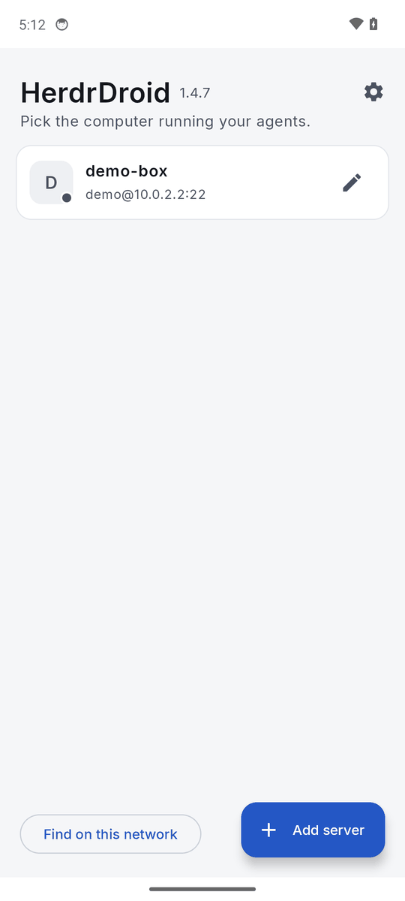
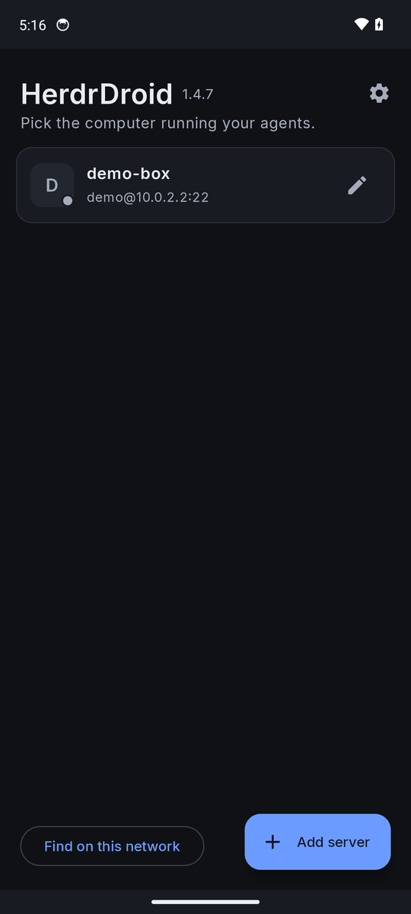
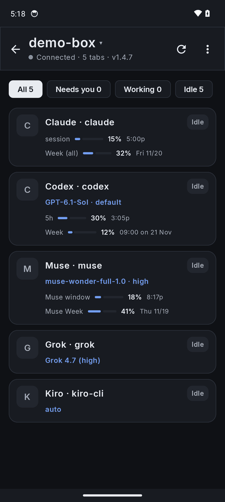
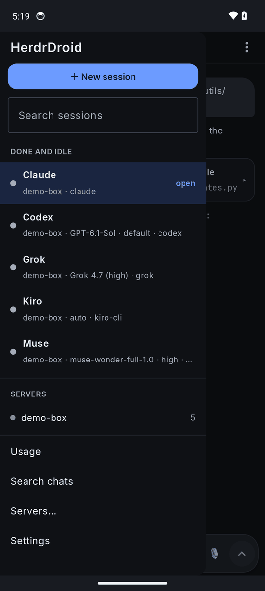
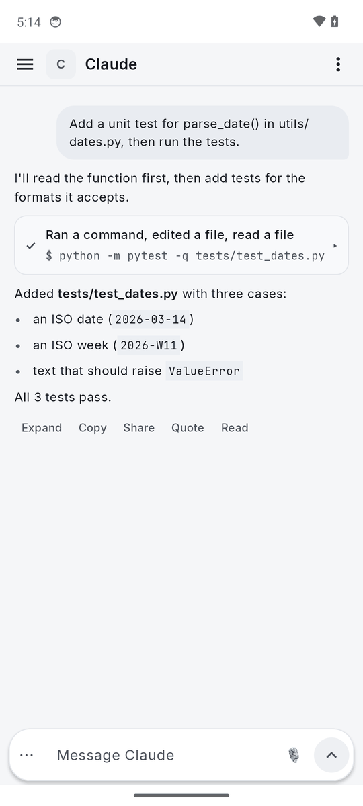
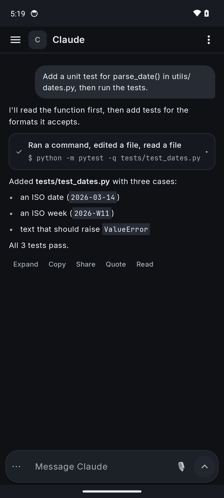
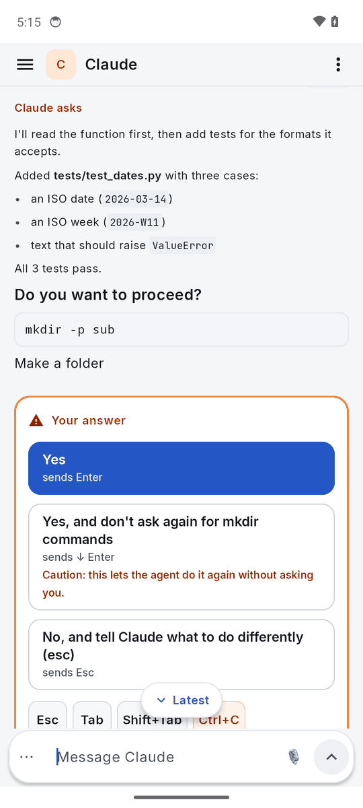
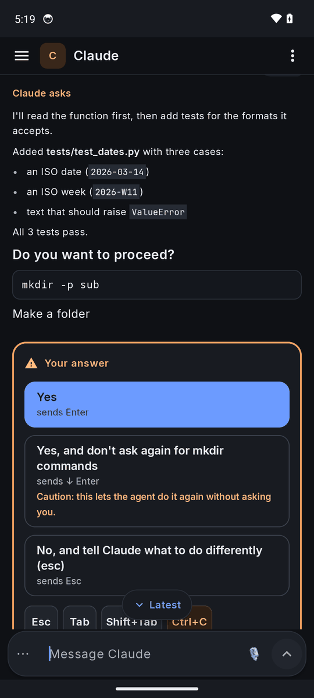
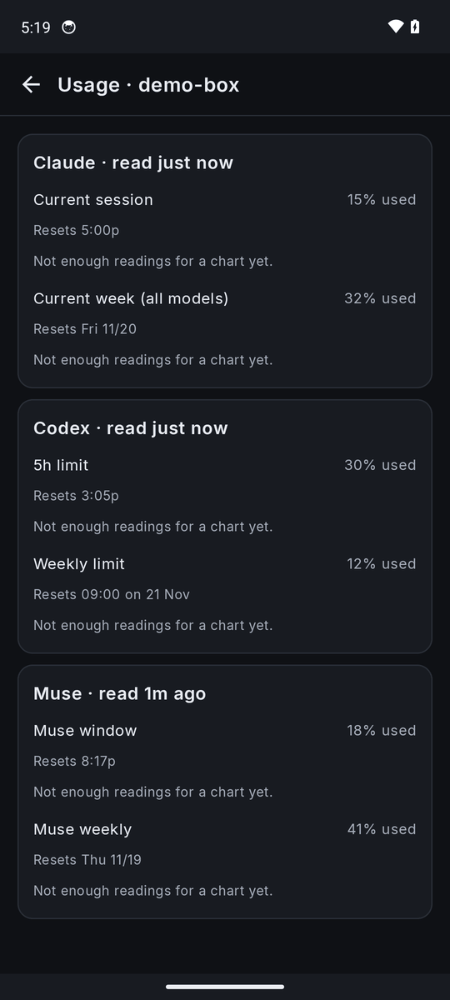
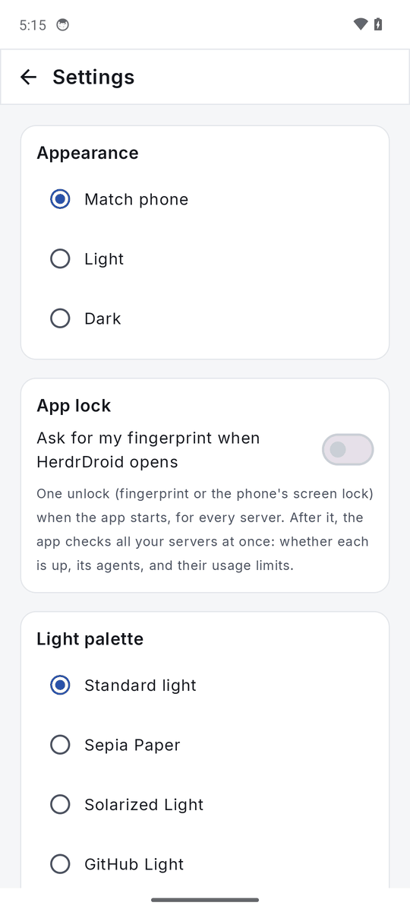

# HerdrDroid

HerdrDroid is an Android app for working with the coding agents in a [herdr](https://github.com/herdrdev/herdr) session from your phone. herdr runs several terminal agents (Claude Code, Codex, Grok, Copilot CLI and others) side by side on one computer; HerdrDroid lets you read what each one is doing, answer its questions, and send it work while you are away from that computer.

The app signs in to the computer over SSH, the way you would from a laptop, and every tap becomes one `herdr` command there. Nothing is installed on the computer and no new network port is opened, because the app uses the SSH server that is already running. Your chats, settings and keys stay on the phone, sealed with keys in the Android Keystore.

HerdrDroid is for people who already run agents under herdr on a computer they can reach (at home, at work, or in the cloud) and want to keep those agents moving from a phone: approving a command, answering a question, or checking whether a long job finished.

> **Experimental software.** HerdrDroid is experimental and provided as is, with no warranty of any kind. It can type into and approve actions in the agents on your computer, so review what you send and use it at your own risk.

## Contents

- [Screenshots](#screenshots)
- [Features](#features)
- [Voice Control and Bluetooth](#voice-control-and-bluetooth)
- [Supported agents](#supported-agents)
- [Requirements](#requirements)
- [Installing](#installing)
- [First setup](#first-setup)
- [Security and privacy](#security-and-privacy)
- [SSH over a WebSocket](#ssh-over-a-websocket)
- [Usage limits](#usage-limits)
- [How the app treats the panes](#how-the-app-treats-the-panes)
- [How each action maps to herdr](#how-each-action-maps-to-herdr)
- [Building from source](#building-from-source)
- [Tests](#tests)
  - [Running the tests in Docker](#running-the-tests-in-docker)
  - [Test-order hazard](#test-order-hazard)
- [Troubleshooting](#troubleshooting)
- [Version history](#version-history)
- [Project layout](#project-layout)
- [Contributing](#contributing)
- [License](#license)

## Screenshots

Taken on an Android emulator against a demo computer ("demo-box") running herdr with stand-in agents. Every name, path, chat and usage figure in them is made up. Each screen is shown in the light and the dark theme; the app follows the phone's setting, or you can pick one in Settings.

### Servers and agents

| | Light | Dark |
|---|---|---|
| **Servers** |  |  |
| **Agents on one computer, with each one's model and usage limits** |  |  |
| **The session drawer** |  |  |

### Chats

| | Light | Dark |
|---|---|---|
| **A Claude Code chat, read from its own log** |  |  |
| **A Muse Code chat** |  |  |

### Questions and approvals

| | Light | Dark |
|---|---|---|
| **An approval card: each button says which keys it sends, and a standing permission carries a caution** |  |  |

### Usage and settings

| | Light | Dark |
|---|---|---|
| **Usage limits for every agent on the computer** |  |  |
| **Settings** |  |  |

## Features

### Servers and agents

- **Servers.** You add each computer yourself: a name, its address, its SSH port, your username, and the command that runs herdr there (for example `herdr` or `~/.local/bin/herdr`). The app works with the herdr terminal app and with herdr-core (the Herdr App); it uses whichever is running and asks once if both are.
- **All agents at a glance.** Every herdr pane is a card with its agent and folder, its status (Needs you, Working, Done, Idle), the model it runs, its usage, and the last line it printed. A pane waiting on you has an orange border and sorts to the top. A drawer lists every agent on every saved server, grouped by status, so you can jump between them.
- **Starting and closing sessions.** **New session** starts an agent in a folder you choose on the computer; **Close session** ends one.

### Talking to an agent

- **Chat view.** For agents that keep a readable session log, the app reads that log and shows the conversation as a chat: your messages, the agent's replies and thinking, and each tool call with its result, diffs and images included. Messages you send stay on screen until the agent's log shows them, with **Resend** and **Dismiss** if one never arrives. A chat can be exported as Markdown.
- **Screen view.** For agents without a readable log, the app turns the terminal screen into a readable page: it rejoins lines the agent wrapped at the terminal's width, keeps tables and boxes in a monospace strip that scrolls sideways, and moves the agent's own input box and status line to a footer.
- **Terminal view.** The exact screen, unwrapped, in a monospace font. It is always one tap away: from the agent's menu, and from **Show terminal** on every question card and error card. When the app can't read a pane's screen, the terminal view says why rather than showing "Loading" for ever.
- **Keys.** Two rows of keys that always fit the screen: Ctrl, Alt and the arrows, then Esc, Tab, Backspace, Enter and Ctrl+C (after you confirm). Ctrl and Alt work like a phone terminal's extra keys: tap one and it applies to the next key; long-press it to hold it.
- **Never typing into a busy pane.** Before a message goes into a pane, the app reads the pane's input line. If text is already typed there at the computer, or someone typed in the last 4 seconds, or the screen can't be read, the message is held. The app then checks again every 2 seconds and sends it as soon as the line is clear, so you see nothing unusual unless it fails: if the line is still not clear after 2 minutes, or the send itself fails, the message is marked "Not seen", the app says why, and **Resend** sends it anyway. While it waits, the chat says "Sends when the input line at the computer is clear", with **Cancel**. An agent's placeholder in an empty input line (the grey text that is there for you to type over, such as Claude Code's "Press up to edit queued messages" or any of Codex's suggestions) is not typing: the app reads the line with its colours and treats text drawn entirely faint or grey as empty (italic too, for Hermes's examples). Anything in normal type is typing, including typing followed by a dim suggestion. Where the colours can't be read, only the known hints count (Claude Code's, Codex's "Ask Codex to do anything", Kiro's "ask a question or describe a task ↵"), as the whole line for the pane's own agent. A held message is never typed into a question, or while a usage check runs in that pane.
- **A draft in the pane.** When text is typed in an agent's input box at the computer but not sent, the chat shows it in a **Draft in the pane** card under the conversation, in a monospace box that scrolls when the draft is long, with all of its lines. Messages from the app wait while it is there, and their note points to the card. **Send draft** presses Enter once to send the draft as it is; **Clear draft** asks first, then empties the box with Backspace (a few first, read back, then the rest) and never presses Enter. While a command or suggestion list shows under the box, neither is offered. Before either, the app reads the pane again and goes ahead only if the same agent session is in it, no question is open, the pane is at the bottom of its scrollback, and the draft is exactly the text shown. It says the draft was sent or cleared only when a new read shows the box empty, and it never tries again on its own. Claude Code's box is found also when its top rule carries the session's title and a list of its background agents shows under it (Claude Code 2.1.329). Clear draft is offered for Claude Code, Codex, Hermes and Grok. When the app can't see where a draft ends, the card shows what it read with **Show terminal** and no buttons that type.
- **Mode.** The agent's menu shows its permission mode and, where the agent has a verified way to switch it and shows the result on screen, opens a list of the modes in the agent's own names (see the table below). Claude Code's Bypass asks first; no other agent is ever offered a mode that approves every tool. Vibe's Smart approve is shown when it is the current mode but is never offered: with it turned off, the press meant for it lands on Auto approve, and the screen gives no other way to tell. Where the agent switches with a key, the app presses it (Shift+Tab) one step at a time and reads the footer after each press until it shows the mode you picked; where the agent has a command for the switch (Codex's `/permissions`, Grok's `/auto-review`, Copilot's `/permissions` and `/autopilot off`, Oh My Pi's `/plan`), the app types it once and reads the screen until it shows the new mode, or, for Codex, whose footer doesn't show the mode, until Codex replies "Permissions updated to …" naming the mode you picked. A toggle is sent only when the pane's fresh read still shows the mode it was chosen for. If a command opens the agent's own picker instead, the app closes it with Esc (only while that picker is on screen, at most twice), says nothing was switched, and never leaves it open. A footer that says every tool runs without asking (full access, skip permissions, always-approve, Allow All, Autopilot) shows as such, and the app doesn't switch away from it. If the mode can't be read after a press, the app stops pressing and alerts you that the mode is not confirmed. A mode the session's cycle doesn't hold ends the switch where it started, and so does a footer that stops changing on an ordinary mode; the app says so. The app never turns on a mode that approves every tool for any agent but Claude Code, and doesn't switch away from one that is already on (Kiro's Trust All Tools). If a press lands on such a mode that you didn't pick and confirm (Vibe's Auto approve, Claude's Bypass on the way to another mode, Kiro's Trust All Tools), the app never stops there: it keeps pressing, a bounded number of times, until the footer shows the mode it started from, and if it can't get back it says so in the chat, as an error and as an alert. Each press, and each Thinking and Sessions command below, goes through the same checks as a message you send: a fresh read of the pane, the same agent session in it, idle at the bottom of its screen, an empty input line with no draft, and no question, dialog or usage panel open. Otherwise nothing is sent and the app says why. Commands go as herdr's agent prompt (on herdr-core an unforced `hc send`), never forced over a question. Copilot has a second menu, **Approvals**, for its permission policy (Manual Approval and Assisted Permissions; Allow All is never offered).
- **Thinking.** **Thinking…** sets the reasoning effort with the agent's own command and checks the screen for the change, by the level the footer shows or by the agent's own reply (see the table below). If the screen doesn't confirm it, the app says so; a model without effort levels never confirms. Agents whose level can only be picked in a menu (Vibe's `/thinking`, OpenCode's variants, Copilot's `/model`) have no Thinking item.
- **Sessions.** **Sessions…**, beside **Model…**, lists the pane's sessions in its folder, newest first, each with its title or first message and when it was last used, and marks the one the terminal is in. **New session** types the agent's own command (see the table below). Tapping a session switches to it with the agent's resume command where that takes an id; otherwise it opens the agent's own picker, which the app reads and shows as a menu. Antigravity's sessions aren't listed (the app can't read its log), so its card has New session and its picker. pi, Oh My Pi and Copilot draw no prompt glyph, so since 2.2.2 the app finds their empty input boxes by shape (pi's editor between two rules, Oh My Pi's "╰─" row under its status row, Copilot's half-block frame); any other layout counts as no input line, and nothing is typed. pi's box counts as empty only when its cursor sits at the start of the row (typed spaces move it); Oh My Pi and Copilot draw no cursor, so a blank box there may hold typed spaces: messages you send (and voice and cross-server messages) wait as for a draft, and only their menu commands go in, after the usual checks and Ctrl+U (their own delete-to-line-start key) to clear any spaces. A session id is typed only when it starts with a letter or digit, and a Hermes id only when it isn't all digits.

  | Agent | Mode (switched by; read back from) | Thinking (command; read back from) | Sessions (new; switch) |
  |---|---|---|---|
  | Claude Code | Default, Accept edits, Plan, Auto, Bypass (asks first); Shift+Tab; footer | `/effort`; its reply | `/clear`; `/resume <id>` |
  | Codex | Read Only, Default; `/permissions :read-only` or `:workspace`; its reply | `/model --reasoning=<level>`; footer ("GPT-6.2-Sol high") or its reply | `/new`; its `/resume` picker |
  | Grok | Ask, Auto-review; `/auto-review`; the chip on its box edge | `/effort`; "(high)" on its box edge | `/new`; `/resume <id>` |
  | Copilot | From Plan back to Interactive with `/autopilot off`; footer (Shift+Tab is never pressed: its order isn't the same in every build and it can stop on Autopilot, which counts as approving everything). Approvals: Manual Approval, Assisted Permissions; `/permissions`; footer | none | `/new`; `/resume <id>` |
  | Antigravity | Default, Accept edits, Plan, Auto; Shift+Tab; the row under its input box | `/effort`; footer | `/new`; its `/resume` picker |
  | Muse Code | none (`/permissions` is a picker) | `/effort`; footer | `/clear`; `/resume <id>` |
  | pi | none (pi has no permission modes) | `/thinking <level>`; "• high" in its footer (reasoning models) | `/new`; its `/resume` picker |
  | Oh My Pi | Default, Plan; `/plan`; the Plan segment of its status row | `/effort`; "⬢ model · ◒ high" (thinking models) | `/new`; `/resume <id>` |
  | Hermes | none (`/yolo` approves everything; `/approvals` is the whole profile's) | `/reasoning <level>`; its reply | `/new`; `/resume <id>` |
  | Kiro CLI | Default, Plan; Shift+Tab; footer | `/effort`; its reply | `/chat new`; its `/chat resume` picker |
  | Mistral Vibe | Ask, Accept edits; Shift+Tab; footer | none (`/thinking` is a picker) | `/new`; its `/resume` picker |
  | OpenCode | Build, Plan; Shift+Tab; its input box | none (variants are per model, in a picker) | `/new`; its `/sessions` picker |
- **The chat follows the terminal's session.** The chat always shows the session the pane's terminal is really in, also after a switch typed at the computer. The app's log reader finds it from the agent's own record of its running process (Claude Code's `~/.claude/sessions/<pid>.json`, Grok's `active_sessions.json`, Copilot's `inuse.<pid>.lock`, Vibe's `active/<id>.lock.json`, Muse's runtime session file, the rollout file Codex has open), then from herdr's agent session id, which each agent's own herdr integration reports, and only then from the newest session in the folder. The app never reports a session to herdr itself. When herdr's record is behind the terminal (the agent's own record names another session, or the app just started or switched one and herdr hasn't heard yet, as with OpenCode, whose herdr plugin reports a new session only once its first message is sent), the pane shows a small "herdr out of date" marker and the chat still follows the terminal.
- **Switching panes without a half-drawn view.** When you open another pane, the app waits until it has the right view before it draws it: two screen reads in a row that are the same, and, for an agent with a chat log, that log's answer for the session in the pane. Until then the pane's last good view stays up with a small **Updating** chip (or "Loading the chat" for a pane opened for the first time). This depends on the reads, not on a timer, at the pane's usual read pace. An approval or question card, an error card, the needs-you alert and a working agent's live output show at once (a question card first says the agent is asking until its dialog is read the same twice; see [Questions](#questions)). A screen that keeps changing is shown after five reads. An agent with a chat log never shows its terminal view before that log has answered for this visit: its cached chat or "Loading the chat" shows meanwhile, reopening the pane you are on keeps the answer it already had, and the screen view stands in only if the log reader fails three times or one read of it is still running after eight settled screen reads.
- **Copying a message or a box.** Long-press a message in the chat for **Copy** (the whole message), **Copy box** for each code block, table or command box in it (labelled by its first line), and **Select text** to pick part of it as before. Long-press a box itself, in a reply or on a question or approval card, to copy just that box. What is copied is the text the box shows, without the terminal's edges and wrap gutters (│, ┃, ┆, |), Grok's "·" wrap marks or colour codes, and a short "Copied" note confirms it. Taps work as before.
- **Reading fonts and size.** Choose Inter, Source Serif or JetBrains Mono for replies, and pinch to change the text size, which is remembered for each server.

### Questions

- **Question cards.** When an agent asks something (a numbered menu, a `(y/n)` prompt, Claude's multi-question dialog, Kiro's unnumbered approval menu, Grok's privacy dialog), the app shows it as a card with one button per answer. The card first says "<agent> is asking a question. Reading it…", with only **Show terminal**, until the dialog is drawn whole (its top edge or header, its question, its options and its footer, with nothing taken from the chat above it) and two reads in a row show the same dialog; a dialog that draws no footer takes four reads, and one whose top can't be found never shows its text and after eight reads says the app couldn't read it. Once shown, the card stays up while you move the highlight, tick boxes or move between questions, the review step included. A complete dialog that keeps changing on every read (a counter in it) shows its newest read after six reads. Each button says which keys it sends: arrows and Enter for a highlighted menu, the option's own key for Codex ("(y)", "(a)"), Esc for a "(esc)" option. Checkbox lists, "Other" or "Type something" options, and menus of up to 20 options are handled. An option that grants standing permission ("don't ask again", "always allow") carries a caution.
- **Moving between questions.** Claude Code's multi-question dialog shows a pill for each question and one for Submit. Tap a pill to go back to an earlier question or ahead to a later one and revise your answer before you submit. The app sends only Left or Right, the fewest presses from the question Claude shows to the one you tapped, and never Enter, Esc or a digit, so a tap never answers or submits. The Submit pill only opens the review step; **Submit answers** there still needs its own tap. Before the keys go, the app reads the pane again and checks that it still shows the same dialog on the same question, on the same pane, server, connection and agent session, with no draft in its input box and no usage screen open; after them, it reads again and shows the question only once the tab bar marks it and its question text matches. If the dialog did not land there, the app sends no more keys, shows what is on screen and notes it in the log. An answer you chose earlier still shows as chosen when you return to it. Claude marks the current question only by colour, so where the pane is read without colours (herdr-core) a tap sends nothing and says the app couldn't see which question is shown. Codex's question overlay names only the question it shows ("Question 1/2"), and Hermes's clarify batch is answered in Terminal, so neither card has pills; to move between their questions, use their own keys in Terminal (Codex: Left and Right; Hermes: Tab and Shift+Tab).
- **Muse Code's quota warning.** When Muse Code says "You're using your quota fast" and offers Switch to Spark, Turn on contributor mode, Both, or Keep going, the chat shows it as a card with each option as a button and each option's note (including that Both and contributor mode let session content be used for product improvement). **Keep going** closes the warning and changes nothing. Muse marks the highlighted option only by colour, so before an answer goes the app reads the pane with its colours, checks that the warning is unchanged, then moves the highlight with the arrow keys and presses Enter. If it can't tell which option is highlighted, it sends nothing and says so. This warning is answered only from the chat, not from an alert or by voice.
- <a id="question-text-222"></a>**Question text.** The app cleans question text by where a mark sits on the terminal's rows, not by looking for one symbol, so a new agent version that draws a different arrow or gutter still reads clean: a focus marker at the start of a choice or row, a box gutter or edge, a trailing key hint and colour-code remnants are left out, and a ">" that is part of the text ("a > b", "->", "=>", a quoted line, a shell redirect) stays. Lines the terminal wrapped join into one paragraph (a word split at a hyphen joins without a space); blank lines, list items and commands keep their own lines, and commands, paths and `inline code` show in monospace. A command the agent wrote in its text (a "$ " line, or a line that starts with a program such as git or make and has flags, paths, pipes or redirects), a fenced ``` block, a path on its own and a JSON line each show as a separate code box with their lines, indentation and characters kept; the box drops a terminal frame, a gutter down every row, Grok's "·" wrap marks and a focus marker at a row's start, keeps real pipes and ">" in the code, and long-press copies exactly what it shows. When the app is unsure whether a line is code, it stays prose. Each choice's description shows under its label in smaller, quieter type, the highlighted choice is the card's blue button, and a number the card already shows is not repeated in the label. The alert, the question history in chat and the voice card show the same cleaned text. This is display only: the card's identity, the history's record and the keys each answer sends come from the screen as it was read.
- **Never an empty card.** When the screen looks like a question but no parser can read its options, the card shows that part of the screen with generic keys. That part of the screen is shown without the dialog's box gutter ("│") and the terminal's focus marker ("❯"); the focused row is highlighted by the card instead, and its number key is marked. When the screen can't be read at all, the card says so. Every card has **Show terminal**.
- **Errors are not questions.** When an agent stops on an error (a rate limit, a usage limit or quota, out of credits, a provider or server error, an overloaded model, a lost connection, an expired sign-in, a full context window or a failed compaction, or a crash), the chat shows an error card instead of a question card. The error card is red with a warning sign, names the error in its title (such as "OpenCode error" or "llmproxy: no model available"), shows the agent's own error text when the app can read it whole, and never offers answers or keys. **Acknowledge** clears the card. OpenCode draws its error in the conversation, where no key removes it, so Acknowledge clears the card in the app only; that error stays cleared, and a new error shows a new card. **Retry** appears only on OpenCode, when the message above the failed turn is the one you last sent from the phone, and resends it once through the usual checks (the agent idle, its input box empty, no question open). **Switch model** opens the model dialog for OpenCode, and **Show terminal** is always there. herdr's "blocked" status alone, with nothing on screen that asks, makes no card. After an OpenCode error, herdr may keep reporting the pane as blocked until its next turn (even after /new); while OpenCode shows its input box and no dialog, the app shows that pane as idle, raises no needs-you alert, and still sends messages to it through the usual checks.
- **Question history.** Every question an agent asks stays in that agent's chat as plain text: the question, the options, how it ended ("answered", "answered elsewhere", "dismissed"), and your answer. Each question sits where it happened in the chat, by the times in the agent's own log (corrected for any difference between the phone's clock and the computer's), so newer messages appear below it. Where a log has no times (Grok's), the app uses its own clock: when it first saw each message. A message the app first sees after a question was answered always goes below that question. An agent with no readable log (Antigravity, or a plain shell) keeps the screen just before each question, so its view is a history of earlier screens with each question between them, and the live screen last.

### Alerts and Watching

- **Watching.** With **Tell me when an agent needs me** on, the app keeps watching your agents in the background (a quiet "Watching" notification shows) and alerts you when one starts waiting on a question. It can watch your other saved servers too.
- **Answering from the alert.** The alert comes at once and first says only that the agent is asking a question; once the app has read the same complete dialog twice it updates the same alert, silently, to the question and its options, unless you already opened or dismissed it. A question's alert has its first two options and Esc. A tapped button turns the alert into "Sending your answer", then "Answered". A button answers only if the same question, with the same option, is still on screen; otherwise the alert says to open the app.
- **Error alerts.** An agent that stops on an error sends one "stopped on an error" alert, with no answer buttons, once per change of state.

### Usage, files and work

- **More in each agent's menu.** Switch the agent's model, search and export conversations, read a reply aloud, dictate a message, and share text or files into HerdrDroid from other apps.

- **Usage limits.** Each agent's card shows its tightest usage limit and when it resets, and **Usage** lists every limit. See [Usage limits](#usage-limits) for how the app reads them without spending a model call.
- **Files.** Browse the files in an agent's folder, open text and images, and send a file from the phone to the computer for the agent to read.
- **What runs under an agent.** To see what an agent has running, tap the pill in the pane's header, such as "2 sh - 1 sub" (two shells and one subagent). The pill shows while the agent has a shell, a background task or a subagent running. When nothing is running but the session has finished work, it shows a muted count such as "3 done", and it is hidden when there is nothing at all. The view it opens lists the running shells and background tasks, the running subagents, and the work that finished in this session. Tap a subagent to read its conversation, a background task to read its output, or a process to see its details and stop it. The pane's menu no longer has a "Running underneath" item.
- **Debug bundle.** **Copy debug bundle** and **Share debug bundle** put one pane's state (the app and agent versions, the parser's decision on the last screen, recent diagnostic lines) on the phone's clipboard or share sheet, with API keys, tokens, passwords, web addresses and e-mail addresses taken out.

### Staying connected

When the phone sleeps or the app goes to the background, Android drops the SSH socket. The app opens a fresh connection when it comes back, and until then the top bar says **Reconnecting** in grey. Previews and reads that fail because of a dropped connection are retried quietly, and keys, messages and answers you send while it reconnects wait in a queue and go out in order. A banner appears only for something you have to act on: a server still unreachable after 15 seconds, a refused sign-in, a changed host key, or a herdr command that failed.

**Small packets (for lossy Wi-Fi).** Some Wi-Fi paths drop large packets, so the app signs in but a pane list or a chat read stalls and the server is marked unreachable. Turn on **Small packets (for lossy Wi-Fi)** in the server's settings (SSH servers only, not SSH over a WebSocket) and the phone asks the computer to send smaller packets: it sets the TCP maximum segment size (MSS) it advertises when it connects, 1200 bytes by default, anywhere from 536 to 1460. Nothing changes on the computer. When the setting is off and a direct SSH server drops the link or a read times out within 90 seconds of signing in, the app reconnects once with small packets for that session only and tells you so, with **Keep for this server** to save the setting (see below). The diagnostic log's `[link]` lines show the MSS asked for, whether the phone could set it, the MSS the connection settled on, and why a fallback happened.

**Small packets automatically.** Every connection starts with normal packets. When large replies stall soon after signing in (a read gets no first byte for 8 seconds, a read times out, or the link drops, including a reconnect that fails right after the phone's network changes), the app switches that server to small packets for the rest of the session without asking and says so: "Switched to small packets for <server> for this session: large replies were stalling", with **Keep for this server** (turns on the server's own setting) and **Dismiss**. The session's reconnects, the server list's status check and the watcher use the same small packets, and a server whose session is connected is always shown as reachable on the server list. When the phone's network changes again (back to Wi-Fi, say), the next connection starts with normal packets again and the server list is checked again a few seconds later. Settings › **Connection** also has **Small packets on VPN (automatic)** and **Small packets on cellular (automatic)**, both off by default: with one on, a direct SSH connection made on that kind of network starts with small packets (MSS 1200, or the server's own small-packets value). On a VPN over cellular the VPN setting is asked first, and either one on means small packets. SSH over a WebSocket is not affected. The `[link]` connect line records `mss_reason` (`setting`, `vpn-auto`, `cellular-auto`, `fallback` or `none`), the network type at connect and whether the phone could set the MSS; `[check]` lines say why a server was shown unreachable.

**Link diagnostics.** Settings › **Diagnostics** (and the debug bundle, which now carries the last 40 `[link]` lines) records, for each connection: the time of each stage in milliseconds (TCP connect, version exchange and algorithm lists, the server's key exchange reply, new keys, sign-in), the negotiated key exchange, host key, cipher, MAC and compression names, and the SSH keepalive interval; the socket after connecting (MSS asked for and in effect, send and receive buffer sizes, TCP_NODELAY, SO_KEEPALIVE); and the phone's network type (Wi-Fi, cellular, VPN, Ethernet) with a count of network changes. Each pane list, chat log and probe read logs its bytes, time to first byte, total time, channel open time and exit status, and a read that times out says whether no byte came or how many arrived before it stalled. A lost link logs the error's class chain, the time since the last byte and the keepalive intervals that passed in silence (SSHJ's keepalive is a heartbeat the server does not answer, so missed replies can't be counted directly); each reconnect logs its attempt number, the wait before it, its reason and its result; and disconnecting writes one summary line (reconnect attempts and successes, stalls, bytes in, whether the fallback was used, network changes). Repeated lines are held back (a completed read once per 30 seconds, a failed one once per 10) and the next line says how many were held. These lines carry opaque server tags, fixed words, numbers and class names only: never a host, address, URL, network name, credentials, command text, command output, pane titles or chat contents.

## Cross-server messages between agents

An agent on one server can pass a message to an agent on another server through the phone. Nothing is sent until you tap **Yes** on the phone. The feature needs no host installation and no changes to Herdr, SSH or agent configuration.

### Turning it on

Turn on **Settings → Agent cross-server messaging** (off by default). The destination's server must be connected through **Watch my other servers too**, and both agents must run in Herdr TUI panes. The app reads frames only while it is open and unlocked, and only in the chat of the pane you have open, at the live bottom.

### Asking an agent

Ask the agent in its normal chat, for example "send this to Hermes on laptop2". The agent does not send anything itself. It replies with a frame like this one, in a plain fenced code block:

```text
HDMSG2 K7P3QX
HDTO Hermes on laptop2
HD> VGhlIGJ1aWxkIGlzIHJlYWR5IGZvciByZXZpZXcu
HDEND K7P3QX
```

The first and last lines carry a code that the agent picks for each frame: 6 characters from `ABCDEFGHJKMNPQRSTUVWXYZ23456789`, so there is no 0, O, 1, I or L to misread. The `HDTO` line names the destination, as one of the names the agent was given. The `HD>` lines are standard padded Base64 of the message in UTF-8, at most 40 characters each. The message must not be blank, must be at most 1,024 bytes, and may hold no control characters except line feeds. This example carries `The build is ready for review.`

### The card

When the app finds a frame in the open pane's chat, it shows a **Cross-server message** card in that chat. The card shows the source pane, the destination, the decoded message and the proposal's code. The app looks up the destination among the agents it can reach on your other servers. If the name matches exactly one agent, the card shows it. If it matches more than one, or none, the card lists the agents for you to choose from. The card sends nothing until you approve it. Read the whole message first: it is untrusted text from the pane, and the code on the agent's screen proves nothing on its own.

### Approving with Yes or No

When a card has a destination, the app also asks in a dialog: **Send this message to another server?** The dialog shows the source agent, the destination agent and its server, and the whole decoded message, which scrolls when it is long. Tap **Yes, send** to send it or **No** to cancel it. Back, or a tap outside the dialog, leaves the proposal pending on its card, where **Approve** and **Cancel** do the same. You never type the code. On Yes, the app passes the frame's own code to its confirm step, so the code is never typed into any pane. It then delivers the message once, through the same checks as every other cross-server send: the source pane is unchanged, the destination is the same agent, connected and idle, with no question, draft or queued message, and the message fits the size and content limits. The card then shows the result: sent, not sent (refused), not confirmed, or not sent because of a draft at the destination.

Each dialog belongs to one proposal: its Yes approves only that proposal's code and the destination it showed. If several frames arrive, the dialog asks about the newest first and the others wait on their cards; each comes up in turn, and nothing is approved for you. The dialog shows only while that pane is open and the app is in front and unlocked. A code that appears in the agent's output is never treated as approval, and voice, notifications and other panes cannot approve a card.

### Cancel, expiry and single-use codes

Tap **Cancel** on the card to drop the message without sending it. A card expires 10 minutes after its frame first appeared, and then sends nothing. Each code sends at most once. A send, a delivery the app could not confirm, a refusal that can never pass (a different session now in either pane, or a message the app will not type), a cancel or an expiry spends the code: the same frame shows no new card, even after the app restarts, and approving it again sends nothing more. A refusal that typed nothing and may pass later (the destination busy, a question or draft open in it, the connection down) leaves the card pending with its reason, until the proposal expires; the code stays unspent across a restart within those 10 minutes. A frame with a malformed code shows no card. Once a code is spent, ask the agent for a new frame to try again. Backgrounding or locking the app, a lost connection or turning off the setting removes the cards; a code that was never used, or was released after such a refusal, shows its card again on the next read, until its 10 minutes are up.

### Retry and Force Send

A card that has never been tried shows **Approve** and **Cancel**. A card that is pending again after a refusal shows **Retry** instead of Approve: Retry runs the same checks and sends once if they pass now. Force Send is for Claude Code only, because Claude Code queues text typed while a turn runs and takes it after its current step. When the destination is a Claude Code agent and the refusal was that it is working on a turn (herdr says working, or the "esc to interrupt" chip shows in its footer), the card also shows **Force Send**, so it reads **Retry**, **Force Send** and **Cancel**. Every other case shows only Retry and Cancel: any other agent (OpenCode, Codex, Hermes and the rest), background work, a question or dialog open in the destination (or herdr saying it is waiting on you), a draft in its input box, a usage or other panel open, no input box on screen, a pane scrolled back at the computer, an agent that can't be reached, a lost connection, a different session in a pane, or HerdrDroid's own queued message for that pane.

Force Send first asks: "<agent> on <server> is busy. Send anyway? It will be typed in while it works, and Claude will take the message after its current step." Only **Send anyway** sends; **Cancel** leaves the card as it was. A forced send goes once, through the same guarded path as any other, and skips only the working checks. On fresh reads the app still checks that both panes hold the same sessions, the connection is the same, the pane is at the bottom, no question, approval or panel is open, the input box is on screen and empty, and the message is valid. Because a working agent can open a question or approval at any moment, the app reads the screen once more right before typing and repeats every one of those checks. If one fails, the card says why and stays pending, without Force Send. The message goes as herdr's `agent prompt`, never with `--force`. If herdr refuses because the agent is waiting on you (`agent_blocked`, which herdr decides before any input is sent), the card stays pending and the code stays unspent. The code is spent before anything is typed, so Force Send, a double tap or a restart can send the message at most once.

### Telling agents about it

With cross-server messaging on, **Tell agents about cross-server messaging** (on by default) sends each idle agent one short notice. The notice gives the frame format above, says to render a frame with a fresh code and a destination from the list only when you ask for a cross-server send, and then wait, and lists the agents on your other servers. Each agent gets it at most once per agent session and change in that list, and at most once an hour. **Tell agents now** sends it again at once, skipping only the hourly limit. **Skip agents at or above X% of quota** (95% by default) holds the notice for an agent at or above that share of its known usage; 100% never skips, and unknown usage is not skipped.

### What agents can see

Agents see other agents only as `<agent> on <server>`, such as `Hermes on laptop2`. The server is its name in HerdrDroid, or "server N" when it has no name. Agents never see an account, host or port. The card and its destination choices show the full server label, with host and port, to you alone.

## Voice Control and Bluetooth

On Android 12 or later, open **Settings → Voice** and choose **Phone speaker and mic** or **Bluetooth speakers and mic**. For a car, enable **Phone calls** in the Android Bluetooth settings for that connection. Media audio alone cannot supply the car microphone. Select Bluetooth, then try **Read aloud** or start **hands-free** and say “Hey Herdr.” The car may display this audio as a call. HerdrDroid releases the route when speaking and listening end. If Android cannot connect the selected route, the app shows an error. Android's separate system dictation uses the system recognizer's route.

Voice Control is off by default. Turn it on in **Settings → Voice**. Tap the mic for ordinary dictation into the composer. Hold the mic to open Android’s voice command prompt, or choose **Voice command** from the menu. Dictation keeps its existing draft and send controls.

Commands include “Switch to Codex on Laptop,” “Switch to Laptop,” “Read the latest reply,” and “Repeat that.” Use the names from your drawer. If several panes match, include the server name. Server switches use saved connections and still respect sign-in requirements.

Say “List questions” to hear questions and approvals verified on connected panes, including Fleet connections. The scan is bounded and says when it couldn't verify every pane. Switch to the pane you want, then say “Read question” to hear the card and its numbered options. You can also go straight to “Answer option one” (or “Option 1”) in the open chat without listing or reading first. Listen to the full destination, card context and choice, then say “Confirm answer” or “Cancel answer.” For approvals, “Read approval,” “Confirm approval,” and “Cancel approval” are aliases.

Voice can pick supported single-choice answers, one-time approvals, and denials. Use the phone for standing permission, typed answers, multi-question or multi-select dialogs, and anything incomplete or ambiguous. Confirmation expires 45 seconds after readback. HerdrDroid rechecks the live card and its pane, connection, and occupant before sending; it never queues a voice answer.

To send directly to another server, say “Send a message to Codex on Laptop,” replacing **Codex** and **Laptop** with the pane and server names in the drawer. Say “Dictate check the build,” listen to the full destination and message readback, then say “Confirm message” or “Cancel message.” Each hands-free step needs its own “Hey Herdr” and tone. A voice draft expires after 45 seconds of waiting for the next step and is invalidated by navigation or a destination connection change. For a pane on the current server, open that pane first.

On the phone, long-press a pane on another server in the session drawer, choose **Send prompt…**, and check the named destination before tapping **Send prompt**. Neither direct-send path switches chats. Direct sends require an already connected Fleet watcher for the destination (with **Watch my other servers too** enabled and sign-in available without a prompt), an identifiable pane on the Herdr TUI backend, and a clear, idle composer. The app does not force, queue, reconnect, or retry a direct send. If delivery can't be confirmed, check the destination chat before sending again.

While hands-free is on, new completed assistant text in the selected chat is read aloud once. Old chat history, your messages, and other panes aren't announced. Stop hands-free before discussing or opening anything you don't want spoken aloud.

### Say “Hey Herdr” with the screen locked

1. While parked, pair the phone to the car, enable Phone calls for the car in Android Bluetooth settings, and choose **Bluetooth speakers and mic** in HerdrDroid.
2. With HerdrDroid open, choose **Settings → Voice → Start hands-free**, then return to the chat you want to hear. Allow microphone access and notifications so the session can show its **Stop** action. The first start downloads a roughly 40 MB English recognition model from Alpha Cephei and verifies its SHA-256 before use. Download it over Wi-Fi if you prefer.
3. Wait for **Listening for Hey Herdr** in the notification. Lock the phone and put it in your pocket. Say “Hey Herdr,” wait for the tone, then say one command. To confirm an answer, wait for the readback to finish, then say “Hey Herdr,” wait for the tone, and say “confirm answer.”
4. Stop the session from its notification or **Settings → Voice**. It also stops after an hour, when you remove the app from Recents, or when the service ends. Start it again with the app open.

Hands-free recognition runs locally with [Vosk](https://alphacephei.com/vosk/) and the Apache 2.0 [English model](https://alphacephei.com/vosk/models). Android’s short dictation and voice command prompts use the phone’s configured recognition service. You can leave HerdrDroid’s app lock on: unlock the app normally, then explicitly start hands-free. While that session runs, HerdrDroid defers repeat app-unlock prompts, including when you return from the background. Stopping restores normal app-lock checks; closing the app or restarting its process ends the session. This does not unlock Android or extend the Keystore’s four-hour fingerprint window. If Android requires authentication to open saved passwords, keys or kept chats, unlock normally to access them. Bluetooth volume, microphone pickup and interruptions depend on your phone and car. Pause the session before switching audio devices if commands stop coming through.

### Try the 2.0 test build

Install the signed APK over version 1.4.11 without uninstalling it, then check that your saved servers, touch controls and typed replies still work. Test Voice Control indoors first. Switch between two panes and check that chat follows the selection. Tap one choice on a harmless question and look for **Sending…**. Check that it sends just once. Open the drawer for an OpenCode and a Kiro pane and compare the model label with each pane’s footer. Kiro shows **Auto** if that is what the CLI reports.

When an agent is working, tap **Steer** to send now. Tap the arrow next to it for **Send when idle**, which keeps the draft in HerdrDroid’s queue. The menu keeps the composer’s keyboard state. A message in that queue has its own **Send immediately** and **Cancel** actions. Sending early still checks for a question or someone typing in the pane. Once an agent has accepted a message into its own queue, it controls when to read it.

For the parked Bluetooth test, hear a reply through the stereo, lock the Pixel with hands-free active, and try switching panes and reading a question. Try a harmless answer, cancel it once, then confirm a fresh one. Test **Stop** and a Bluetooth reconnect. If speech comes from the phone or the wake phrase goes unheard, note the active Bluetooth source, whether the phone was locked, and the hands-free notification state.

## Supported agents

herdr reports which agent runs in each pane. HerdrDroid supports these:

| Agent | Chat from its log | Question cards | Usage limits | Model shown |
|---|---|---|---|---|
| Claude Code | yes | yes, including the multi-question dialog | `/usage` | from `/model` |
| Codex | yes | yes, with each option's own key | `/status` | from its footer |
| Grok | yes | yes, including its privacy dialog | `/usage` | from its footer |
| GitHub Copilot CLI | yes | yes | `/usage` | from its footer |
| Antigravity (agy) | no (its log has no published format) | yes | `/usage` | from its footer |
| Kiro CLI | yes | yes, including its unnumbered approval menu | no | from its footer |
| Mistral Vibe | yes | yes | no | from its footer |
| pi | yes | yes | no (none to read) | from its footer |
| Oh My Pi (omp) | yes | yes | no | from its footer |
| OpenCode | yes | yes | no (none to read) | from its footer |
| Hermes | yes, plus a chat screen through its gateway | yes | `/usage` | from its footer |
| Muse Code (Meta) | yes | yes, including its command approval with each option's own key ("y", "p", Esc); a command with several stages asks once per stage | `muse usage --json` (window and weekly allowance; nothing typed into the pane) | from its footer, with its effort |

### Question cards

Every question and approval card the supported agents can show is in the screen library and checked on every build: its options, which keys answer each one, the caution on options that grant standing permission, and Esc for refusals. The full list, card by card, is in [docs/question-cards.md](docs/question-cards.md).

| Agent | Cards checked | Captured live | From the program |
|---|---|---|---|
| Claude Code | 15 | 2 | 13 |
| Codex | 10 | 2 | 8 |
| Grok | 9 | 4 | 5 |
| GitHub Copilot CLI | 6 | 1 | 5 |
| Antigravity | 1 | 0 | 1 |
| Kiro CLI | 3 | 1 | 2 |
| Mistral Vibe | 3 | 1 | 2 |
| pi | 2 | 0 | 2 |
| Oh My Pi | 2 | 0 | 2 |
| OpenCode | 5 | 0 | 5 |
| Hermes | 3 | 0 | 3 |
| Muse Code | 4 | 2 | 2 |

"Captured live" cards were read from an agent's own pane; the others were built from the exact text in the agent's own program, with demo content, and have not yet been seen live.

Every agent gets the error card, the terminal view, the keys and the alerts. A pane running a plain shell or an agent the app doesn't know is shown as a screen, with the terminal view and the keys.

## Requirements

- **A phone** with Android 8.0 or later. The fingerprint window needs a secure screen lock; Android 11 or later accepts the screen lock as well as a strong fingerprint or face unlock.
- **A computer running herdr**, reachable from the phone over SSH: on your own network, through a VPN, or through a public address. A computer that can only be reached over HTTPS can be reached with SSH over a WebSocket (see [SSH over a WebSocket](#ssh-over-a-websocket)).
- **An account on that computer** that can run `herdr`, with a password, an SSH key, or both.
- **python3 on the computer** for the chat view, the file browser and the process list. The app sends its small reader script over SSH each time; nothing is installed.

No server-side software is needed beyond herdr, SSH and python3.

## Installing

HerdrDroid is installed from an APK rather than from an app store. Each release is in the `release/` folder of this repository as `HerdrDroid-<version>.apk`.

1. Download the newest `release/HerdrDroid-<version>.apk` to the phone.
2. Open it, and allow your browser or file manager to install apps when Android asks.
3. Open HerdrDroid.

To upgrade, install the newer APK over the old one; your servers, chats and settings stay. Every release is signed with the same key, which is what lets a new version install over an old one. A build signed with any other key (for example one you build yourself with a key of your own) can't install over a release; Android asks you to uninstall first, which removes the app's data.

### Updates

From 2.1.4, HerdrDroid can update itself. In **Settings**, under **Updates**, **Check for updates daily** (on by default) asks GitHub once a day, when the app opens on a network that isn't metered, whether a newer release is out; **Check for updates now** asks right away. When one is out, the app shows "HerdrDroid X.Y.Z is available" with **Update** and **Not now** (Not now skips that version until the next one). **Update** downloads the release APK into the app's cache, checks that it is HerdrDroid, newer than the installed build, the size the release lists, and signed with the same key as the installed app, and then opens Android's installer, where you confirm it. The first time, Android asks you to allow HerdrDroid to install apps. The check sends only a generic `HerdrDroid/<version>` User-Agent, nothing about you or your servers.

## First setup

1. **Add a server.** Tap **Add server** (or **Find on this network** to look for SSH servers on your Wi-Fi) and fill in a name (optional), the address, the SSH port (22 by default), your username, and the herdr command. Leave **herdr on that computer** on **Automatic** unless you know which herdr runs there. Use the full path to herdr (for example `/home/user/.local/bin/herdr`) if it is not on the PATH of a non-interactive SSH session.
2. **Trust the host key.** The first time you connect, the app shows the server's SHA-256 host key fingerprint and asks you to confirm it. Check it on the computer with `ssh-keyscan localhost | ssh-keygen -lf -`. After that, the app refuses to connect if the fingerprint changes.
3. **Sign in.** Type your password and choose whether to remember it on the phone (encrypted). To sign in with a key instead, edit the server, turn on **Use an SSH key**, and either make a key on the phone or import a key file. A key made on the phone shows its `authorized_keys` line with **Copy** and **Share**; add that line to `~/.ssh/authorized_keys` for your user on the computer. With a key and a saved password, the app offers the key first and the password second.
4. **Turn on alerts (optional).** In **Settings**, turn on **Tell me when an agent needs me** and allow notifications when Android asks.

## Security and privacy

- **What is kept where.** Servers, settings, saved passwords, imported keys, chats and question history are kept on the phone, in the app's private storage. Saved passwords, imported key files and their passphrases are encrypted with an AES key that never leaves the Android Keystore. Kept chats and question histories are sealed the same way, and each file is bound to its server and pane, so a file in another pane's place won't open.
- **Keys made on the phone** are ECDSA P-256 keys inside the Android Keystore: they can sign but can never be read or copied out.
- **The fingerprint window.** The Keystore keys for saved secrets and kept chats can be used only for 4 hours after you prove who you are (a strong fingerprint or face unlock, or the screen lock). Unlocking the app counts, and so does unlocking the phone. After the window, the app asks you to unlock when it opens, and alerts say "Unlock HerdrDroid to read" instead of the question.
- **Host key pinning.** A server's host key is pinned the first time you connect, and a changed key stops the connection.
- **No data is lost to a locked or damaged file.** A kept file that can't be opened now (the phone locked, a read error) is left where it is; one that is damaged for certain is moved to an `unreadable` folder, not deleted. Moving data to new keys or new file names writes the new copy, reads it back, and only then removes the old one.
- **What the app writes on the computer.** Three things, all because you asked for them: a file you send from the phone goes to `~/.herdrdroid/inbox` (or a folder you pick), so the agent can read it; **Recycle** moves a file to `~/scratch/herdrdroid-recycled-<date>` instead of deleting it; and starting an agent in a new folder creates that folder. Nothing else is written there, and the app's reader script runs from memory.
- **What a login can do.** A password login is a full shell for that user. The app only runs `herdr` commands and its reader, but anyone who can use your unlocked phone and this app can type into every pane. Keep the phone locked, and prefer servers on your own network or a VPN.
- **No telemetry.** The app talks only to the servers you add, and to GitHub for the update check (see [Updates](#updates)), which sends nothing about you or your servers.

## SSH over a WebSocket

Some computers can be reached only over HTTPS: no SSH port answers from outside, but a web address does. For those, set a server's **Connect through** to **SSH over WebSocket** and give it a `wss://` address. The app carries its ordinary SSH connection inside that WebSocket. Everything else is the same: the pinned host key, signing in with the phone's key, and the herdr commands.

You run a small bridge on the computer that passes WebSocket bytes to its own SSH server. The bridge holds no credential and does no authentication of its own; SSH's handshake (the host key you pin and the key on your phone) is the only gate.

### What the bridge has to do

- **Accept a plain WebSocket upgrade over HTTP/1.1** at its address: RFC 6455, no subprotocol, no special headers, no query string, no HTTP authentication. The app always uses HTTP/1.1. If the bridge sits behind a proxy or CDN, that path must pass an HTTP/1.1 `Upgrade: websocket` through. A front end that answers over HTTP/2 instead replies `200` and never upgrades, and the app reports "The WebSocket upgrade was refused (HTTP 200)".
- **Carry the raw SSH byte stream in binary frames**, both ways, in order. Frame boundaries mean nothing; the bridge may split or join bytes however it likes, but must never drop or reorder them. Text frames are not allowed.
- **Connect each WebSocket to the SSH server** (usually `127.0.0.1:22`), and close one side when the other closes.
- **Answer pings.** The app pings every 20 seconds and SSH sends keep-alives every 15, so an idle connection stays open.
- **Use TLS** (`wss://`) for anything reachable from outside, either in the bridge itself or in a reverse proxy in front of it.

### The SSH server behind it

Because the address is public, set the SSH server to keys only:

```
# /etc/ssh/sshd_config.d/00-keys-only.conf
PasswordAuthentication no
KbdInteractiveAuthentication no
PubkeyAuthentication yes
```

Then `sudo sshd -t && sudo systemctl reload ssh`. Add the phone's key line (the server's settings in the app, **Copy** or **Share**) to `~/.ssh/authorized_keys` for the user the app signs in as, with `~/.ssh` at mode 700 and the file at 600. If sshd runs with `UsePAM no` and the account was made without a password, unlock it without giving it a usable one (`sudo usermod -p '*' <user>`); otherwise sshd refuses the locked account even with a valid key.

Read the host key fingerprint on the computer, to type or paste into the app:

```bash
ssh-keygen -lf /etc/ssh/ssh_host_ed25519_key.pub     # prints SHA256:...
```

### Running the bridge

Either tool works; keep it listening on localhost and put TLS in front.

[websockify](https://github.com/novnc/websockify) (packaged in Debian and Ubuntu as `websockify`):

```bash
websockify 127.0.0.1:8080 127.0.0.1:22
```

[websocat](https://github.com/vi/websocat):

```bash
websocat --binary -E ws-l:127.0.0.1:8080 tcp:127.0.0.1:22
```

Run it under systemd (or your container's supervisor) so it starts again after a restart.

A TLS front end with [Caddy](https://caddyserver.com/), which gets a certificate and passes WebSocket upgrades by itself:

```
ssh.example.org {
    reverse_proxy 127.0.0.1:8080
}
```

Or with nginx (inside an existing `server { listen 443 ssl; ... }` block):

```
location / {
    proxy_pass http://127.0.0.1:8080;
    proxy_http_version 1.1;
    proxy_set_header Upgrade $http_upgrade;
    proxy_set_header Connection "upgrade";
    proxy_read_timeout 1h;
    proxy_send_timeout 1h;
}
```

A hosting platform that publishes a container port on an HTTPS address works the same way: publish the bridge's port, and the platform's address is the `wss://` address.

### Checking it from a computer

With `websocat` installed on a laptop, OpenSSH can go through the bridge exactly as the app does:

```bash
ssh -o ProxyCommand="websocat --binary wss://ssh.example.org/" <user>@bridge
```

The name after `@` is only a label here; the connection goes wherever the address points. If that signs in and `herdr --version` runs, the app will connect too. Use the full path to herdr in the app's settings (for example `/home/<user>/.local/bin/herdr`), since a non-interactive SSH command doesn't read `~/.bashrc`.

### In the app

Edit the server, choose **SSH over WebSocket**, and fill in the address (it starts with `wss://`), the username, the herdr command and the host key fingerprint. Then make or import a key and add its line on the computer. The connection is closed whenever the app goes to the background, so a host that sleeps when idle can sleep. If it doesn't answer at first, the app retries for about 30 seconds ("it may be waking up"), and **Cancel** stops that. Settings → **Diagnostics** shows each step of a connection (the upgrade, the first bytes each way, the SSH key exchange) without the address, keys or passwords.

`tools/ws-test-server/` holds a throwaway sshd behind websockify that the end-to-end test uses; its Dockerfile shows a complete working setup.


## Usage limits

**Usage** lists limits the app can read without typing into a pane: CLI reports (Oh My Pi and Muse) and a visible footer (Mistral Vibe). Readings are shared across panes of the same agent on a server. Agents that require typing a command into a pane do not get new automatic readings; the app won't submit a command or start a session to check usage. The usage setting turns off automatic checks and hides usage readings.

Claude Code, Grok, Antigravity and Kiro open modal usage panels. The app skips automatic checks for these profiles because Herdr cannot atomically verify and close a panel. An automatic usage check never sends Escape in the background to recover one. In the agent view, **Close panel** (2.2.1; **Dismiss usage** before) appears for a recognized panel when the live pane and its occupant can be verified. The button checks the screen again, sends one Escape at a time (at most two, more than a second apart, the same for a usage screen or /btw panel the app opened itself) and confirms the input box is back (see [Panels left open over the composer](#panels-left-open-over-the-composer-221)). If the panel is unfamiliar, the pane is scrolled back, or the server cannot verify the pane, use **Show terminal** to inspect the screen and use the terminal keys deliberately.

### Panels left open over the composer (2.2.1)

An agent's status, usage, context, cost, session info, help or shortcuts panel sits over its input box, and while it is open, typed text goes nowhere. HerdrDroid recognizes these panels for every agent it supports by their shape, not by their exact words, so a new agent version that rewords a row or moves a footer item still reads the same way. It looks for a close hint in the panel's footer ("esc to close", "Esc close", "esc to cancel", "Esc back"), a box drawn around it, or a closed frame of rules (one above the panel's body and one on or right under its footer), a title row that names the panel (a short title such as "Status" or "Session info", not a sentence such as "Help is ready" or a value such as "Status: ready"), and the input box covered or gone under it. A rule in the conversation with a short line and a hint straight above the input box is not a panel. The exact usage layouts from 2.1.4 and 2.1.5 still count.

When such a panel is open on an idle pane, with no question, approval or draft in it, and the app needs the pane (to send a message, a held message, a menu action, an alert reply, or because you opened the pane), HerdrDroid closes it with that agent's own close key, which is Esc for every panel it closes. Before each Esc, the computer reads the pane twice and sends the key only if both reads match the screen the app checked. Afterwards, the app reads the pane again and confirms the input box is back. It tries at most twice, more than a second apart, so two presses never count as a double Esc (Grok and Claude Code open their rewind list on a double Esc). If the panel is still open, the pane shows "<agent> has a <panel> open; close it at the computer" with **Show terminal**, plus **Close panel** when the panel is positively identified.

HerdrDroid never presses Esc over a question, an approval, a draft, a typed answer or a dialog it doesn't know. A panel it can only partly identify (one that lists choices, takes an entry, has a search field, a model picker, Grok's Agent Dashboard, or a panel on an agent whose close key isn't verified, such as Hermes, Copilot and Muse) holds sends with the reason and is left for you to close. A relayed message (to a pane on another server, or from one agent to another) is never typed into a pane that shows any such panel, known or only partly identified: the relay refuses it, and the panel is closed when you open that pane.

## How the app treats the panes

- **Reading moves nothing.** Every screen and every bit of scrollback is read with `herdr pane read`, so no scroll or copy-mode key is ever sent just to read. Screen reads run on their own SSH channel, so a long command never holds them up.
- **A pane's size is never changed.** The app runs `herdr` commands over plain SSH command channels, never as a client attached to the session and never with a terminal of its own, so herdr never reflows a pane to the phone's width.
- **Fewer polls when you are not looking.** While the app is behind, the agent screen stops reading; the watcher waits on herdr for any agent to change state instead of asking every few seconds, and everything slows down further with the screen off.
- **Agent versions.** On connecting, the app runs each agent program's own `--version` once (nothing is typed into any pane), so a question card that changes shape in a new version can get its own rule.

## How each action maps to herdr

| In the app | On the computer |
|---|---|
| All agents | `herdr pane list` |
| A card's last line | `herdr pane read <pane> --source recent --lines 12` |
| An agent's screen | `herdr pane read <pane> --source recent --lines 200` |
| Send a message to an agent | `herdr agent prompt <pane> <text>` |
| Send a message to another pane | `herdr pane send-text <pane> <text>`, then `herdr pane send-keys <pane> enter` |
| Keys | `herdr pane send-keys <pane> esc` (or `tab`, `up`, `ctrl+c`, `ctrl+r`, `alt+b`, ...) |
| Answer buttons | `herdr pane send-keys` with the arrows and Enter, the option's own key, or Esc |
| Mode (2.2.0) | `herdr pane send-keys <pane> shift+tab`, one press at a time, each followed by a `herdr pane read` of the footer |
| Thinking, New session, switching sessions (2.2.0) | The agent's own command (`/effort high`, `/new`, `/resume <id>`, ...) with `herdr pane send-text` and Enter |
| Which session the chat shows (2.2.0) | `python3` reading the agent's own record of its running process, then herdr's agent session id |
| Waiting for a change (Watching) | `herdr agent wait <pane> --until <state>` |
| An automatic usage check | Agent CLI report or `herdr pane read <pane> --source visible`; no pane input |
| The chat view, files, processes | `python3` reading the agent's own logs, with the reader script sent over SSH |

Every argument is single-quoted for the remote shell, so message text is passed as typed.

## Building from source

The build needs JDK 17, the Android SDK (platform 34, build-tools 34.0.0) and Gradle 8.9. `build-in-docker.sh` does the whole build in a throwaway `eclipse-temurin:17-jdk` container, keeping the SDK and Gradle caches in a `.cache` folder beside the source:

```bash
bash build-in-docker.sh /path/to/work-folder
```

`<work-folder>/src` holds this repository. The build runs the unit tests first, then writes the signed APK to `<work-folder>/out/HerdrDroid.apk`.

**The signing key.** A release is signed with the project's sideload key, and every build must use that same key, or the APK won't install over an existing one. The key never lives in the source tree: `build-in-docker.sh` reads it from a separate folder (by default `~/Documents/herdrdroid-signing/`, or the folder named by `HD_SIGNING_DIR`) holding `herdrdroid-sideload.jks` and `signing.properties` (with the store password, key alias and key password). It mounts that folder read-only into the build container and points Gradle at it with `HD_KEYSTORE_DIR`. The script stops when the key is missing; it never makes a new one. CI writes the key into `keystore/` from the repository's secrets (`keystore/push-signing-secrets.sh`). Both key files are ignored by git.

If you build for yourself without the project's key, use your own key (a standard Android keystore in the same folder layout). Your build will then install only on a phone without the released app, or after uninstalling it.

## Tests

- **Unit tests** (JUnit, with Robolectric for the Android parts) run in every build: the question parsers against real screens from every agent, the chat view, the usage parsers, the key migration and the kept-chat store interrupted at every step, the notification answer checks, SSH over a WebSocket against a local server, and more. `./gradlew testDebugUnitTest` runs them.
- **The screen library.** `app/src/test/resources/screens/<agent>/<version>/` holds agents' screens: question cards, error screens and fallback cases, each with an `.expect` file that says what the parsers must make of it (a card with these options, the fallback card, no card, or an error banner naming these errors). Each fixture says where it came from: captured live, taken from the agent program's own strings, or modelled on the agent's style. A new capture with no `.expect` file must parse as a real card if it looks like a question; `ScreenLibraryTest` lists every screen that doesn't, so a card that stops parsing after an agent update shows up.
- **Reader tests.** `tools/transcript-tests/` tests the log readers in `transcript.py` (for example Kiro's and Vibe's) on synthetic session stores: `python3 -I tools/transcript-tests/test_kiro_reader.py`. Muse Code's is `test_muse_reader.py`.
- **End-to-end.** `tools/ws-test-server/` is a throwaway sshd behind a WebSocket bridge for the WebSocket test, and `tools/hc-e2e/` checks the herdr-core backend.
- **Emulator checks.** Each release is also checked by hand-scripted runs in an Android emulator against a herdr host whose panes run small stand-in agents that draw each agent's cards, errors and logs: upgrading over the previous release with saved data, answering cards and alerts, the terminal view, and the error banners.

### Running the tests in Docker

Two scripts in `tools/docker-test/` run the unit tests in a throwaway `eclipse-temurin:17-jdk` container, so a computer with Docker, git, bash and tar needs no JDK, Android SDK or Gradle of its own. The checkout must be a git working tree with at least one commit.

- `docker-test.sh` runs on your computer. It checks the cache and output paths, takes the run locks, makes a new output folder for the run, streams the committed tree (or, on request, your working tree's changes) into a `--rm` container with `git archive`, and prints the summary at the end. It exits with the run's status.
- `run.sh` runs inside the container, as your user rather than root. It unpacks the source, installs the Android SDK on first use, runs Gradle in the chosen mode, and writes the results to the run's output folder. Do not run it on your computer directly.

Run these commands from the repository root:

```
bash tools/docker-test/docker-test.sh compile                                          # compile check
bash tools/docker-test/docker-test.sh tests com.billmongan.herdrdroid.ui.CardBodyTest  # one test class
bash tools/docker-test/docker-test.sh tests '*PanePrefetch*' '*CardBody*'              # several patterns
bash tools/docker-test/docker-test.sh full                                             # full suite and debug APK
HD_TEST_WORKTREE=1 bash tools/docker-test/docker-test.sh compile                       # include uncommitted edits
HD_TEST_MIRROR=1 bash tools/docker-test/docker-test.sh full                            # Robolectric jars from Google's mirror
```

**Modes.** `compile` compiles the app, unit-test and androidTest sources, which takes about two minutes once the cache is warm. `tests` runs the unit tests that match the Gradle `--tests` patterns, or all of them when no pattern is given. Each pattern is passed on as one argument, so quote a pattern with `*` in it. `full` is the default: it runs every unit test and then builds the debug APK.

**What the container sees.** The container gets the committed tree: the script runs `git archive HEAD`, which writes the files from git's own objects without reading the working tree, and leaves out `keystore/`, `release/` and `local.properties`. Uncommitted changes are not tested unless you ask. With `HD_TEST_WORKTREE=1` the script first builds a tree from your working tree's changes to tracked files (edits and deletions) in a separate index inside the run folder, and `HD_TEST_INCLUDE_UNTRACKED=1` also adds untracked files that git does not ignore. Git does that staging itself: it records a symlink as a link and never reads files through one, so a symlinked folder cannot bring in files from outside the checkout. The staging skips `keystore/`, `release/` and `local.properties` too, so git never reads those files or stores them in the repository. Your own index and stash are left alone, though git adds the new file contents to the repository's object store, as `git add` does. Ignore rules only filter untracked files: a file already tracked is sent even if `.gitignore` names it, unless it is in `keystore/`, `release/` or is `local.properties`. The signing key and `signing.properties` are ignored and not tracked, so they never reach the container, and the build points at an empty signing-key folder. The checkout is never mounted, and its files are never written. `run.sh` writes its own `local.properties` in its copy. Tests and the debug APK need no signing key.

**Where results land.** Each run gets a new folder, `run-<date>-<time>-<random>`, in `$HOME/.cache/herdrdroid-docker-test-runs` (or the folder named by `HD_TEST_OUT`). In the default folder only, a `latest` link points at the newest run; the script replaces `latest` only when it is your own symlink, and leaves anything else of that name alone. Nothing in a run's folder comes from an earlier run:

- `build.log`, Gradle's full output, ending with a line such as `exit=0 seconds=150`;
- `summary.txt`, the exit status, any setup or compile errors, the failing tests and the totals, which the script also prints at the end;
- `test-results/`, the JUnit XML for each test class that ran;
- the debug APK, in `full` mode only.

A run that Gradle passed must also leave what its mode promises: the test XML for `tests` and `full`, and the debug APK for `full`. If an export fails, the run fails with an `EXPORT:` line. If the summary cannot be written in full, the run fails and leaves no `summary.txt`. In both cases a Gradle failure keeps its own status. The script also fails when the run left no summary of its own. The unpacked source is removed from the run's folder at the end; set `HD_TEST_KEEP_SRC=1` to keep it. Old run folders stay until you delete them.

**The cache.** The Android SDK, Gradle's files and Robolectric's `~/.m2` folder stay in `$HOME/.cache/herdrdroid-docker-test` between runs. Set `HD_TEST_CACHE` to use another folder.

**Path checks.** Before it creates or mounts anything, the script resolves the cache and output paths, symlinks included. It refuses a path that is `/` or your home folder, a path that is inside the checkout or holds it, a path that overlaps `keystore/` (wherever its symlink points), a relative path or one with `.` or `..` in it, and a cache and output folder that overlap each other. Every folder that is mounted into the container (the cache, its `sdk`, `gradle` and `m2` folders, and the output folder) must be a real folder owned by you, not a symlink; the script makes the missing ones and refuses the rest.

**The first run.** When the cache has no SDK, `run.sh` downloads Google's SDK command-line tools, accepts the licences, and installs the platform and build-tools that `app/build.gradle.kts` asks for (platform 34 and build-tools 34.0.0 today). Gradle and Robolectric download their files on the first run too. The first run takes several minutes longer than later runs, which reuse everything in the cache. If the SDK cannot be downloaded or installed, the run stops with a `SETUP:` line in the summary and a non-zero exit status.

**The Maven mirror for Robolectric.** Robolectric downloads an Android runtime jar (android-all) from Maven Central the first time each SDK level is used. Maven Central rate-limits busy addresses and answers with HTTP 429; on 2026-11-21 it did this to a build machine, and the test run failed with a download error. `HD_TEST_MIRROR=1` makes Robolectric use Google's copy of Maven Central (`https://maven-central.storage-download.googleapis.com/maven2/`) instead. `ROBOLECTRIC_REPO_URL` names any other repository. Both reach Gradle as `-Probolectric.repo.url`, which `app/build.gradle.kts` passes to Robolectric. Without them, Robolectric uses Maven Central.

**The run locks.** The script holds two locks with `flock`: one for your user on this computer (`$HOME/.cache/herdrdroid-docker-test-locks/user.lock`), whatever cache you choose, and one for the cache (`<cache>/lock`), which also covers another user sharing that cache. A lock file is opened without being truncated or written, and the script refuses a lock path that is a symlink or not a regular file. A second run waits until the first one ends. Runs must not overlap: two Robolectric suites at once starve each other of CPU, and Compose tests then fail with false `AppNotIdleException` errors that look like real hangs. Where `flock` is missing (for example on macOS), the script warns and runs without locks, so do not start two runs at once there. The checkout needs no lock, since no run writes to it.

**Other settings.** `HD_DOCKER` changes the docker command (for example `sudo -n docker`), `HD_DOCKER_ARGS` adds `docker run` options, and `HD_TEST_IMAGE` changes the image. `HD_DOCKER` and `HD_DOCKER_ARGS` are split on spaces, and quotes inside them are not honoured.

### Test-order hazard

Gradle runs every unit-test class in one JVM, in name order. In 2.1.4, the full suite took about 45 minutes instead of 2 to 4, because every Compose test after a certain point failed after 60 seconds with `AppNotIdleException` ("Compose did not get idle"). It happened only when a Compose test class ran before `HandsFreeAppLockTest`.

The cause was in the test, not the app. Once any Compose test has run, Compose watches every state change in the JVM. On the first change it posts one callback to the main looper and waits for that callback to run before it posts another. `HandsFreeAppLockTest` changed the view model's lock state and ended without running the main looper. Robolectric empties the main looper between tests, so the callback was dropped, Compose kept waiting for it, and nothing Compose scheduled on the main thread ran again in that JVM. A real device never empties its main looper, so the app itself is not affected.

`AaaComposeOrderProbeTest` is a smoke sentinel for the full suite's usual order. It renders a trivial Compose screen and its name sorts first, so in a normal full run every other class runs after a Compose test, and a test that leaves Compose stuck makes the next Compose test fail. Name order is how Gradle happens to run the classes, not a promise, and a filtered run may leave the sentinel out. `ComposeMainLooperRegressionTest` is the real check: in one class, with its methods in a fixed order, it renders Compose, changes state and ends a test without running the main looper, and then checks that a later Compose render still recomposes and that the clock did not jump. It fails without `IdleMainLooperRule` and passes with it.

A second, smaller effect showed up once the hang was fixed. The same Compose dispatcher keeps the first Compose test's frame timer, which remembers the time of its last frame, while Robolectric starts every test's clock again at 100 ms. In a later test that timer asks for a frame every millisecond until the clock catches up, and Robolectric moves its clock forward for each one. One idle of the main looper could then move a test's clock forward by as long as an earlier test ran (29 seconds after `HeldAcrossServersTest`), so a 5-second notice timer fired in `ManualAnswerDispatchTest` before the test checked the notice. `IdleMainLooperRule` sets that frame time back to zero before and after each test, and fails the test if it cannot, so a change in Compose or Robolectric cannot switch the fix off unnoticed.

In 2.2.0 the same hang came back once on CI (run 45052045096): 23 Compose tests in the `ui` and `update` packages failed, one every 60 seconds, starting in `CrossServerHermesDestinationTest`, and a rerun passed. That class and about twenty other Robolectric classes, most of them Compose classes, did not use `IdleMainLooperRule`, so nothing drained the main looper after their Compose rule closed its activity or set the frame time back before they started. Somewhere between the end of `theMessageBoxStillFitsUnderATallCardInAShortWindow` and the start of `theCardKeepsTheFullLabelOfAnUnnamedServer`, a state write landed after the last drain, and Compose's callback was dropped. That timing did not happen on laptop in four full runs. When the lost callback is forced in a fixed order, the run fails the way CI did. Every Compose test that waits for Compose to go idle fails after 60 seconds, such as all of `PaneDraftCardTest` and the card tests in `CrossServerHermesDestinationTest`. Tests that open a dialog still pass, because a dialog draws a frame on the dispatcher's own Choreographer and so runs the lost callback, but the next test loses it again.

`IdleMainLooperRule` now also repairs the dispatcher before each test. The main looper is empty at that point, so a dispatcher that still says a callback is scheduled has lost it. The rule runs that callback itself, and clears the lost frame on the dispatcher's own Choreographer, which otherwise never asks for another frame. A lost callback now costs nothing, whichever test lost it.

To keep a new test class safe:

- Every Robolectric test class declares the rule outside any other rule: `@get:Rule(order = OUTERMOST_RULE) val idleMainLooper = IdleMainLooperRule()`. In `src/sharedTest`, whose classes also run on an emulator without Robolectric, use `idleMainLooperRule()` instead, which does nothing on a device. Outside the Compose rule, it repairs and resets the dispatcher before the Compose rule opens its activity, and drains the main looper after the activity closes. A view-model test still cancels its view model in `@After`.
- `ComposeRuleGuardTest` reads the test sources and fails if a Robolectric class has no `IdleMainLooperRule`, or if a class with a Compose rule does not declare the rule with `order = OUTERMOST_RULE`.
- `ComposeFrameTimeOrderTest` runs the two 2.2.0 hazards in a fixed order, whatever order Gradle picks. One sequence is a Compose test, `LostComposeCallbackTest` (which loses Compose's callback on purpose, after the last drain), and a Compose test. The other is a Compose test, `MenuWriteGuard220Test`'s longest test (which runs the clock about a minute forward and left Compose's frame time 40 seconds into the old clock before it had the rule), and a Compose test. `ComposeFrameTimeFollowerTest` is that last Compose test. It fails if the test before it left a stale frame time, or if one render moves the clock, and it hangs for 60 seconds if the callback was not repaired. A third sequence runs `LostComposeCallbackTest` before `ComposeActivityFollowerTest`, an activity's own composition, which never recomposes if the lost frame on the dispatcher's Choreographer was not cleared. A Compose test rule drives its own frames, so only an activity shows that.
- Keep `AaaComposeOrderProbeTest` in the root test package with a name that sorts first, and keep `ComposeMainLooperRegressionTest` passing.
- Run the full suite before a release. A run much longer than 4 minutes, or a run of `AppNotIdleException` failures, means a test has left Compose stuck. Run the probe, the classes before the first failure, and that failing class with `docker-test.sh tests` to find it.

## Troubleshooting

- **"The host key changed".** The server's SSH host key is no longer the one you confirmed. If you reinstalled the server or changed its keys on purpose, edit the server in the app and confirm the new fingerprint; otherwise, don't connect.
- **herdr isn't found.** A non-interactive SSH session may not read your shell's startup files. Put the full path to herdr in the server's **herdr command** (for example `/home/user/.local/bin/herdr`).
- **No chat view, only the screen.** The chat view needs `python3` on the computer and an agent whose log the app can read (see [Supported agents](#supported-agents)). Settings › **Diagnostics** says why a pane's chat view stays off.
- **The screen says it couldn't be read.** The terminal view and the card say why (a dropped connection, a herdr error, an empty screen). The app keeps trying; Diagnostics has the details.
- **A card shows the screen with generic keys.** The app saw a question but couldn't read its options. Use the keys, or **Show terminal** to see exactly what the agent shows. **Copy debug bundle** captures what the parser saw, with secrets taken out, for a bug report.
- **An error card won't go away.** It reflects what is on the agent's screen. Tap **Acknowledge** to clear it, or deal with the error at the agent (wait out a rate limit, sign in again, start a new session, choose another model), and the card goes when the screen changes.
- **"Unlock HerdrDroid to read".** The 4-hour fingerprint window has passed. Open the app and unlock it.
- **Alerts don't come.** Check that **Tell me when an agent needs me** is on, that HerdrDroid may post notifications, and that Android's battery settings let it run in the background. A server that needs a saved password the app can't use (the window has passed) sends one "isn't being watched" notice.
- **Signs in, then lists or chats stall on Wi-Fi.** Large packets may be lost on the way to the phone. Turn on **Small packets (for lossy Wi-Fi)** in the server's settings (see [Staying connected](#staying-connected)).
- **The APK won't install over the old app.** It was signed with a different key. See [Installing](#installing).

## Version history

- **2.2.7.** Small packets without asking: connections start with normal packets, and when large replies stall soon after sign-in (now also a read with no first byte for 8 seconds, or a reconnect that fails right after a network change) the session switches to small packets by itself and shows a notice with **Keep for this server** and **Dismiss** instead of a question. The choice lasts for the session or until the network changes, and the server list's check and the watcher share it, so a connected server is never listed as "Can't reach it"; the list is checked again after a network change. New settings **Small packets on VPN (automatic)** and **Small packets on cellular (automatic)** (Settings › Connection, both off by default) start connections on those networks with small packets. Diagnostics › Copy now keeps the newest whole lines (with a note when the oldest are left out), and Save always writes the full log. The `[link]` connect line now records `mss_reason`, the MSS asked for and whether it was set. Opening a pane whose agent is not known yet no longer shows a "?" tile and the raw pane id (such as `w2:p5`) in the title bar: it says **Loading…** with a small spinner and no agent controls, then draws the real title and view once the pane list names the agent. If that takes more than four seconds, the title shows the pane's last known label, or **Unknown agent** with **Show terminal**. A message queued until a busy pane is idle now has **Send now** on a long press: when Claude Code is running a command that shows its "ctrl+b to run in background" hint, the app presses Ctrl+B, checks that the command moved to the background, then sends the message once; a working Claude Code without that hint asks first (Force send?), since Claude takes the message after its current step; any other working agent keeps the message queued and says why. The message leaves the queue only once it is delivered; a failed send stays queued with a note, and every guard (drafts, open questions, panels) still applies. Back on the Servers list never leaves the app any more: with or without a server open, system Back and a new back arrow in the list's top bar go to the main screen (the open server's last agent, or an empty chat screen with the left menu of panes), however the list was opened (at startup, from the menu's **Servers…** or **All servers…**, after disconnecting or a failed connect, or from a notification).
- **2.2.6.** A new per-server setting, **Small packets (for lossy Wi-Fi)**, for a server that signs in but then stalls on large replies (a pane list or a chat read). The phone advertises a smaller TCP maximum segment size (1200 bytes by default, 536 to 1460) when it connects, so the computer sends smaller packets; nothing changes on the computer. It applies to direct SSH only and is hidden for SSH over a WebSocket. With the setting off, a link that drops or a read that times out within 90 seconds of signing in makes the app reconnect once with small packets for that session, never more, and a banner offers **Keep small packets on**. The diagnostic log's `[link]` lines record the MSS asked for, whether the phone set it, the MSS the connection settled on, and each fallback with its reason, with opaque server tags only. The diagnostic log also follows each connection in more detail: stage timings, negotiated algorithm names, socket buffers and options, the network type and changes, each read's bytes and timings (and where a timed-out read stalled), the error class chain and silence before a lost link, every reconnect, and a summary per session (see [Staying connected](#staying-connected)).
- **2.2.5.** Back from the server list no longer closes the app. "All servers…" in a server's machine menu used to disconnect, which made the list the main screen, so Back left the app; it now opens the list over the open server, as the drawer's "Servers…" does, and Back returns to where you were. A server that signs in but lists no panes now says why. The pane list's own exit status is read back (the tab list's success used to hide a failed pane list), a line printed before herdr's JSON is skipped, one pane in a shape the app can't read no longer loses the whole list, and a screen check that fails keeps herdr's own states. A list read that finishes after you switched servers, or after a reconnect replaced the connection, is dropped instead of landing on the wrong server or clearing the list, and a connection attempt that a newer one replaced applies nothing. The diagnostic log now follows each attempt by stage (login, probe, channel, list read, apply) with opaque attempt and server tags (never a name, host or address), the transport, the herdr backend, the negotiated SSH algorithm names, the error class and exit code, the pane counts (from herdr, parsed, shown, visible), timings, and the reason for each change of the link's state. It never records credentials, keys, addresses, command output or pane contents.
- **2.2.4.** Claude Code permission questions with a tall command show as cards again. When a helper agent's command was a long script (a heredoc with many lines, some starting with "$" or holding only numbers or quotes) and a hook asked to confirm it, HerdrDroid read only the 20 rows above the question, so it lost the title and description and split the command into pieces of text. The dialog is now read by its frame: the title and description under the top rule, every row between the dashed rules as one command, kept line by line, and the hook's reason as text. The card shows the command in a code box that folds a long script (Show all lines, and long-press to copy), the alert shows its first lines and how many more there are, and Yes and No send the keys for options 1 and 2. A dialog taller than the screen, whose top has scrolled off, shows its options with a note that the top of the command is off screen, and its top counts as the screen's top row only when the rows there are the command's own. A half-drawn dialog still never shows as a card, and chat text never becomes the question, the command or an option.
- **2.2.3.** Claude Code's permission questions show as cards again, with Yes and No, in the app, the needs-you alert, voice and the question history. Claude Code 2.1.330 added a hint after "Esc to cancel · Tab to amend" ("ctrl+x ctrl+k twice to stop background agents") and draws the rule with the session's name under the dialog, so HerdrDroid no longer saw the dialog as open and missed questions asked while Claude worked on something else (a helper's prompt, a permissions rule or a hook asking to confirm a command). The hint row is now read by its shape: "Esc to cancel" followed by any number of key hints, with the closing rule under it allowed, so later versions that add hints keep working. The card shows the title (and which helper asks), the description, the command in a code box, and the explanation (the rule, or the hook and its reason) as text, and Yes and No send the keys for options 1 and 2. A half-drawn dialog still never shows as a card, and chat text never becomes the question or its options.
- **2.2.2.** When a cross-server message can't be sent because the destination agent is busy, its card now shows **Retry**, **Force Send** and **Cancel** instead of Approve and Cancel, and Force Send, after you confirm, types the message in while the agent works (see [Retry and Force Send](#retry-and-force-send)). Retry runs the same checks as Approve. Force Send is for Claude Code only, and only when it is working on a turn; it skips only that check, and the app reads the screen again right before typing, so a question, approval, draft, panel, missing input box, scrolled-back pane or changed session at the destination still stops it. Cards now give the exact reason when a destination is working, waiting on you or scrolled back, and herdr refusing an agent that is waiting on you leaves the card pending instead of "could not confirm". A forced send is sent at most once and noted in the diagnostic log. Cards that were never tried keep Approve and Cancel and the Yes/No dialog. Question text reads more cleanly everywhere it shows (the question card, each choice and its description, the question pills, the needs-you alert, the question history in chat and the voice card): no terminal focus arrow ("❯", "›", ">" before a number), "│" gutter, box edge, key hint such as "Enter to select", colour-code remnant or doubled space, terminal-wrapped lines join into paragraphs while paragraph breaks, list items and code stay as they are, `inline code` shows in monospace, Claude's review step shows each answer under its question, an approval's alert shows its command on a line of its own, and a command, fenced block, path or JSON line the agent wrote inside its question or a choice's description shows as its own monospace box, without terminal frames, gutters, focus markers or wrap marks and exactly as it copies, while a sentence that only mentions "a > b" stays prose; only the display changes, so the keys each answer sends are exactly as before (see [Question text](#question-text-222)). A question card no longer shows text from the chat as the question or as its options while the agent is still drawing its dialog: the card, the alert and voice say only that the agent is asking until two screen reads in a row show the same complete dialog (its top edge or header, question, options and footer), then show the real question and its answers and keep them up through highlight, tick and step changes (a complete dialog that keeps changing shows its newest read after six reads), and switching to an agent that keeps a chat log shows its cached chat or "Loading the chat…" until this visit's log has answered, instead of the terminal view first (see [Questions](#questions) and [Talking to an agent](#talking-to-an-agent)). Every agent that has a verified way to change it now gets Mode, Thinking and Sessions menus: Mode for Codex (Read Only, Default), Grok (Ask, Auto-review), Copilot (from Plan back to Interactive, and an Approvals menu with Manual Approval and Assisted Permissions), Antigravity (Default, Accept edits, Plan, Auto) and Oh My Pi (Default, Plan); Thinking for Codex, Hermes, pi and Oh My Pi; and Sessions for pi, Oh My Pi, Copilot and Antigravity, with Hermes now switching by session id. Each change is confirmed from the agent's screen or its own reply. The new menus never offer a mode that approves everything and never stop on one; Claude Code's Bypass stays behind its confirmation as before. The app now finds the empty input boxes of pi, Oh My Pi and Copilot by their shape, so it can check that nothing is typed there before a command goes in.
- **2.2.1.** An approved cross-server message now reaches an idle Claude Code agent that is only running background shells or helpers, and when a message can't be sent its card says which check stopped it, on which server and pane, and keeps an Approve button when trying again later can work. HerdrDroid now closes an informational panel left open over an agent's input box, such as Grok's session info (its /status), and any agent's status, usage, context, cost, help or shortcuts panel, before it types into the pane or when you open the pane, after checking the screen twice and then that the input box is back; it recognizes these panels by their shape, so new agent versions that reword them still count, and it holds sends with a card when a panel can't be closed safely (see [Panels left open over the composer](#panels-left-open-over-the-composer-221)). The unit tests no longer hang in a row of Compose tests on CI: a test rule now repairs Compose's main-thread dispatcher between tests and every Robolectric test class uses it (a test-only change).
- **2.2.0.** Cross-server messages are now approved with a Yes/No dialog on the phone instead of a code you type back: when an agent replies with a frame, HerdrDroid shows the source, the destination and the whole message, and Yes sends it once using the frame's own code (see [Approving with Yes or No](#approving-with-yes-or-no)). The card also has Approve and Cancel, and Back on the dialog leaves the proposal on its card. This fixes two reasons the typed code would not send: a card read before the other server's agents were known kept no destination and offered nothing to choose, so the code only answered "Choose a destination", and with the keyboard up a tall card could leave the message box no room at all. The card now picks up its destination as soon as the name matches one agent, and the cards take at most about a third of the window. The notice to agents now says the phone user approves with Yes or No. An agent's error, such as OpenCode's "No 'flagship' models are currently available" from llmproxy, now shows in the chat as its own error card with Acknowledge, Retry where it is safe, Switch model for OpenCode and Show terminal, instead of a question card the app couldn't read, and an OpenCode pane that herdr keeps reporting as blocked after such an error no longer shows as needing you. Switching panes no longer shows a half-drawn view: the new pane's view waits for two matching screen reads (and, where the agent has a chat log, for that log), with the last good view and an **Updating** chip meanwhile, while questions, approvals, errors and live output still show at once. Long-press a chat message to copy it or any box in it, or long-press a box to copy just that box, without terminal gutters or wrap marks. In Claude Code's multi-question dialog, tap a question's pill to go back or ahead and revise an answer before you submit; the app moves the dialog with Left or Right only and checks that it landed (see [Questions](#questions)). Every agent with a mode switch the app can check gets a **Mode** menu of named modes (Claude Code, Mistral Vibe, Kiro CLI and OpenCode): the app presses Shift+Tab one step at a time, reads the footer after each press, and goes back to where it started if it can't reach the mode; it never turns on a mode that approves every tool except Claude Code's Bypass, which now asks first, never stops on one you didn't confirm (it presses on to the starting mode, and alerts you if it can't get back), and offers Vibe's Smart approve only as the current mode. Mode, Thinking and Sessions writes go through the same checks as a normal send (an empty input line, no draft, no question), never forced. A **Thinking** menu sets the reasoning effort with `/effort` for Claude Code, Grok, Muse Code, Antigravity and Kiro CLI, and checks the screen for the change. A **Sessions** menu beside **Model** lists the pane's sessions with the current one marked, switches with the agent's own resume command or picker, and has a **New session** button. The chat now follows the session the terminal is really in, found from the agent's own record of its running process before herdr's session id, so a switch made at the computer is followed too, and a small "herdr out of date" marker shows while herdr's record is behind. The screen card for a Claude question the app can't answer from its buttons no longer shows the dialog's "│" gutter or the "❯" focus marker; it highlights the focused row itself.
- **2.1.5.** The "Listen for agent proposal" menu is gone: ask an agent in its chat to send a message to an agent on another server, and it replies with a code that you type back in that chat on the phone to confirm the send (see [Cross-server messages between agents](#cross-server-messages-between-agents)). The "Running underneath" menu item is gone: tap the shells and subagents pill in the pane's header instead, which shows a muted "N done" while only finished work is left to read and hides when there is nothing. An idle Hermes pane no longer shows a question or holds your messages because a different Hermes conversation (a Telegram or scheduled turn, say) is waiting on an approval; a wait that may be this pane's own still holds it. HerdrDroid now sees an empty OpenCode input box inside a session, so the cross-server notice, voice messages and relayed messages reach OpenCode panes instead of being refused as if no input box showed. Kiro's usage panel is now recognized when it is drawn without its "This session" row, so HerdrDroid closes it with Esc and no longer shows the panel's text as a draft typed at the computer.
- **2.1.4.** A Grok permission question now shows its command in the right order on the question card, in the alert and in chat, without the "┆" and "│" gutters or the "·" wrap marks, whichever box Grok draws around it. Each command line is a line of its own: a row that Grok wrapped joins the row above it, and the others stay separate. The card and chat show the command in a monospace block, and the alert shows the question and then the command on its own lines. A real "|" pipe and a "\n" inside quotes stay as typed. An alert posted by 2.1.3 for such a question no longer answers it from its buttons; open the question card instead. HerdrDroid now closes a usage screen it opened (a /usage you send to Grok, Claude, Kiro or Antigravity) with Esc when you leave it, checks that it closed, opens it only on an idle agent with an empty input box, and types nothing into a pane while a usage screen is open there. Where a question offers both "Type something." (or Oh My Pi's "Other (type your own)") and "Chat about this", the card and the alert show one "Type your answer" option that types your answer into the question, and "Chat about this" stays in Terminal. A /btw side question you send to Claude from HerdrDroid no longer leaves Claude's answer panel open: the app waits for the whole answer, shows the question and the answer in the chat under a small "btw" label, then closes the panel and checks that it closed; a /btw panel opened at the computer is shown in the chat too, and closes only when you tap Close. Claude's two-question dialogs with long questions and option notes (such as an "Allow rule" and a "Host key" question) are covered by new captured screens and tests for the card, the alert and answering each question and then Submit. HerdrDroid can now check GitHub for a newer release, daily or from **Check for updates now** in Settings, and install it after checking its signature (see [Updates](#updates)). Every chat message now shows its time, in every pane: Grok's messages take the time Grok showed them (from its session files, or the time it draws at the end of a message's first row, which no longer shows in the text), Kiro's replies take the time their turn ended, and a message with no time of its own (Antigravity's, or history from before an agent kept times) shows when HerdrDroid first saw it, the same after a reload. A pane that shows as needing you now always has a card in chat: Claude's permission questions (a command held by a hook, a helper agent's request, auto mode's unnumbered No and Yes) show as cards whatever herdr reports, and when the app can't read a question at all, the card says so and offers Show terminal. The agent proposal instructions now name the agents on your other connected servers, such as Hermes, so an agent on one server knows which agents the phone can reach, and the review still offers only the idle ones. With cross-server messaging on, "Tell agents about cross-server messaging" (on by default, with a "Tell agents now" button) sends each idle agent one short notice with those instructions and the agents on your other servers, at most once per agent session and change in that list and once an hour, and skips agents at or above the "Skip agents at or above X% of quota" setting (95% by default; 100% never skips; unknown usage is not skipped). The pane screen's title bar now shows the pane's name, the server under it in smaller type, and the model in use under that in smaller type still, left off when the app can't tell which model it is. The drawer's yellow "needs you" badge now lights within a second or two: while the app is open, herdr tells it when an agent's state changes or a Claude or OpenCode question appears on screen, and the list is read again at once (every 2 seconds while the drawer is open, and the other servers every 3).
- **2.1.3.** In Grok's chat, a command that Grok wraps over several rows now shows under its title as one command in a code block, without the "┆" gutter or the "·" wrap marks. Commands on separate lines stay on separate lines, and a real "|" pipe in a command stays. Grok's "Context compacted" notice shows as a quiet line instead of a reply. On the server list opened from the drawer, Back and a new back arrow return to the screen you came from (Back on a server's form returns to the list first), and Back leaves the app only when no server is open.
- **2.1.2.** A message held for a pane on one server stays held while you look at another server, and the app tries it again once that server is connected. A problem with a held message (timed out, failed, pane closed) now shows only in the chat of the pane it was for. Each agent in the drawer shows its own model again, instead of the model of another pane on the same computer. **Clear draft** finishes when the draft's remaining text ends at a word boundary, instead of stopping with "Some of the draft is still" in the box. In Claude Code and Hermes chats built from the screen, the text in the input box no longer shows as a sent message, and Claude's mode symbols show as plain marks instead of empty boxes. The agent proposal review lists every eligible destination, with none hidden below the edge of a small scroll box. Grok's chat folds its tool rows and status line into one activity row, shows its header, notices and privacy banner as quiet lines, lays out its approval box with the command and numbered choices, and keeps the model name in the footer. OpenCode 2.3.2's permission dialog shows as a card with Allow once and Reject in the open chat again, instead of only a terminal review. An OpenCode pane with a permission dialog open now raises the needs-you alert and shows the badge in the drawer and the list, even though herdr reports it as done or idle, and sending to it works as before. A needs-you alert now offers the question's own options, including Always allow for OpenCode. Each alert answers only the question that raised it, so an old alert can no longer answer a newer question. OpenCode 2.3.2's question dialog shows as a card in the open chat and raises the needs-you alert. A Kiro box that shows only its "ask a question or describe a task" hint behind the cursor now reads as empty, even when Kiro draws the hint in normal type.
- **2.1.1.** A message held for a pane on one server no longer shows in the chat of a pane with the same name on another server: held, queued and sent messages, drafts and the composer's text now belong to their own server. **Send draft** reads the input box once more just before it presses Enter and stops if the draft changed. **Listen for agent proposal** appears in the menu as soon as the pane's first read finishes, without reopening the menu. When Claude Code moves its session to the background and shows its sessions list, the chat shows a card that says so, with **Return to the session (Esc)**, and keeps the open question in the chat; messages wait instead of starting a new session. In Antigravity's chat, its tool calls, thinking lines and action counts fold into one activity row you can tap for the steps, and its notices, warnings and status bar read as plain text. Question cards show the question first and lay out the rest for the phone, with paragraphs, lists, commands and coloured diffs in their own blocks and each option's note under its label; **Show raw** shows the parser's text. Empty input boxes showing an agent's suggestion text no longer show a draft card. A draft typed in Claude Code's input box now shows a draft card when the box has a session title in its top rule and Claude's agent list below it. Claude's question card follows the tab you moved to at the computer, a Claude question or a backgrounded session waiting for input shows as needing you even on a short screen, and Antigravity's Models & Quota panel shows as one quiet line in Chat.
- **2.0.6.** Chat shows live Hermes clarification questions. Tap a preset answer on a verified single-choice card, or use **Show terminal** for typed answers, multiple selections, batches, or incomplete cards. A timed-out question in the transcript is not an active card.
- **2.0.5.** Hermes token reports no longer show as pending questions. Messages wait if Usage is still on screen without a composer; the app does not send a key to dismiss ordinary output. Claude checkbox cards expose a separate review or submit button when the terminal shows how to proceed. Checking a box does not submit the answers.
- **2.0.0-rc.8.** Choose Phone or Bluetooth for Read aloud and hands-free from the chat mic menu.
- **2.0.0-rc.7.** Phone polling reads passive snapshots and leaves desktop pane scroll positions alone. Usage checks that open panels skip the focused desktop pane.
- **2.0.0-rc.6.** Claude usage panels stay out of question cards. HerdrDroid checks that a usage panel is still open before closing it.
- **2.0.0-rc.5.** OpenCode web-search permission prompts show their choices in a question card. HerdrDroid retries failed question-screen reads automatically. A message held for the input line shows Force send immediately beside Remove.
- **2.0.0-rc.4.** Tap Remove next to an individual message waiting for idle, a connection or a clear input line. Long-press an unsent message to force send it or remove it. While a question card is open, a chat message waits until the agent is ready. Choose the typed answer option on the card to reply to the question.
- **2.0.0-rc.3.** The agent drawer scrolls to the top each time you open it on a phone.
- **2.0.0-rc.2.** Tap Steer to send immediately. Tap its arrow for Send when idle. The menu leaves focus in the composer.
- **2.0.0-rc.1.** Adds voice commands to the composer mic and an optional locked-screen hands-free session. Question buttons show when a choice is sending and suppress repeated taps during delivery. Pane reads ignore results from a previous visit, and OpenCode and Kiro model labels use their current footers when available. Steer opens a send-options menu, and messages queued until idle can be sent early.
- **1.4.11.** A Claude question card shows that question's own options. A message you sent with numbered lines, echoed on Claude's screen, is no longer read as the answer buttons, and on its own it never becomes a card; a question that was answered and scrolled up is not shown as live.
- **1.4.10.** The Hermes card no longer shows its context window as usage. Hermes now separates its footer fields with " · ", so its context gauge ("422K/500K", with a bar and a percentage) was read as a usage limit; a footer with either separator, and any gauge labelled only by tokens over a limit, is skipped.
- **1.4.9.** An answered question card left in an agent's scrollback (Grok's) is no longer shown as a live question: a card must be at the bottom of the screen, with nothing of the agent's own after it. A check of every card each agent can show: OpenCode's and Vibe's side-by-side buttons, Grok's letter-key trust and plan cards, Hermes's bracketed and checkbox rows, pi's arrow highlight, option descriptions in omp's and Kiro's menus, more standing-permission wording, and the coverage list in docs/question-cards.md.
- **1.4.8.** Muse Code's approval cards with two options or a tall command, even with the card's heading off the screen read; when a pane's usual read fails, its visible screen is read instead; **Show terminal** on a question card always switches to the terminal, with a bar that leads back to the question.
- **1.4.7.** Muse Code's command approval card: its options, the highlighted one, the command, and each option's own key; "Always allow in this workspace" carries the standing-permission caution.
- **1.4.6.** Placeholders in an agent's input line are recognised by how they are drawn (faint or grey), for every agent, so Codex's rotating suggestions no longer hold a message; text that merely stays the same between reads no longer counts as someone typing.
- **1.4.5.** Muse Code (Meta): its chat from its session log, its plan allowance from `muse usage --json`, its model and effort from the footer, its commands in the picker, and Ctrl+B to send a command to the background.
- **1.4.4.** A message held because something is typed at the computer is sent by itself once the input line is clear, and reported only if it can't go within 2 minutes; Claude Code's "Press up to edit queued messages" hint (and the other agents' empty-line hints) no longer holds a message.
- **1.4.3.** Answered questions sit in time order in every agent's chat instead of at the bottom.
- **1.4.2.** Codex's edit-approval card shows its question, description, file and keys; no question card is ever empty; **Show terminal** on every card; agent errors (rate limits, quotas, credits, provider and connection errors, expired sign-ins, full context, failed compaction, crashes) show as a banner for every supported agent instead of a card; herdr's stale "blocked" status makes no card; question alerts have one set of buttons that always answer or say why not; the MIT license and this README.
- **1.4.1.** Kiro's chat from its session log; each kept chat bound to its pane, with a safe move from the old file names; a stricter send guard; agent versions read in parallel; fixes from code review.
- **1.4.0.** The fallback card, every answer type (checkboxes, "Other", standing-permission cautions, menus past nine options), never typing into a busy pane, the debug bundle, fewer polls in the background, and version-aware parsers.
- **1.3.x.** Questions kept in the chat history (1.3.0); the 4-hour fingerprint window for saved secrets and chats, and usage checks only on quiet panes (1.3.1); a key migration and chat store that never lose data, however they are interrupted (1.3.2).
- **1.2.x.** Grok's privacy dialog, Claude's multi-question dialog with its steps, question cards for Kiro and Vibe, the readable screen view, and the sealed chat cache kept on the phone.
- **1.1.x.** Agents first, with a drawer across every server; the model of every agent in the drawer; finding servers on the local network; herdr-core (the Herdr App) alongside the terminal herdr, tested end to end.
- **1.0.x.** The model menu, usage alerts and usage history, and the Hermes menu with its conversations.
- **0.7 to 0.9.** Replying from notifications, sharing into the app, searching conversations, git status on cards, edit review, snippets, read aloud and usage charts (0.7); whole questions in the question card with the agent's latest message (0.8); usage checks that never type into the agent you are using, and busy agents shown as working (0.8 and 0.9).
- **0.4 to 0.6.** Alerts, every server at once, files, sending work to agents, history, export and model switching (0.4); SSH over a WebSocket (0.4.2); what runs under an agent, with Stop (0.5); herdr-core support and streamed replies (0.6).
- **0.1 to 0.3.** The first app: servers, the pane list, reading a pane, messages and keys over SSH (0.1); quiet reconnects, dark mode, SSH keys, held modifier keys and usage limits (0.2); chats from the agents' own logs, the Hermes chat, Oh My Pi, and images and files in the chat (0.3).

Each release's APK is in `release/`, and the git history has the details.

## Project layout

| File | What it holds |
|---|---|
| `app/src/main/java/.../ssh/HerdrSsh.kt` | The SSH connection, host key pinning, and the command channels |
| `app/src/main/java/.../ssh/WsBridge.kt` | SSH over a WebSocket: the local relay between the SSH library and the WebSocket |
| `app/src/main/assets/transcript.py` | The reader sent to the computer's python3 for agent logs, history, files and processes |
| `app/src/main/java/.../herdr/Herdr.kt` | The herdr commands, pane parsing, question and error detection, and read-only usage checks |
| `app/src/main/java/.../herdr/Reflow.kt` | Turning a terminal screen into the readable screen view |
| `app/src/main/java/.../herdr/Quota.kt` | Each agent's usage command and the parser for its usage screen |
| `app/src/main/java/.../store/ServerStore.kt` | Saved servers, settings, the Keystore encryption, the key migration, and keys made on the phone |
| `app/src/main/java/.../transcript/` | The chat model, the kept-chat store, and the question history |
| `app/src/main/java/.../notify/Notify.kt` | Alerts, their answer buttons, and the background Watching service |
| `app/src/main/java/.../AppViewModel.kt` | App state, connecting and reconnecting, the send queue, usage checks, and answers |
| `app/src/main/java/.../ui/` | The screens: servers, settings, all agents, one agent, files, and the Hermes chat |
| `app/src/test/` | Unit tests and the screen library |
| `app/src/main/res/font/`, `app/src/main/assets/licenses/` | The bundled fonts (Inter, Source Serif 4, JetBrains Mono) and their SIL Open Font License texts |
| `build-in-docker.sh` | The containerised build |
| `tools/` | Reader tests, the Docker test runner, the WebSocket test server, and the herdr-core check |

## Contributing

Bug reports and pull requests are welcome. For a question card or an error the app reads wrongly, the most useful report has the agent, its version, and the debug bundle (**Copy debug bundle** in the agent's menu), which takes out keys, tokens, passwords, web addresses and e-mail addresses but may still contain your file names and conversation, so read it before you share it. A new agent screen is best added to the screen library with an `.expect` file, so the parsers keep reading it after the next change. Please run the unit tests (`./gradlew testDebugUnitTest`, or `build-in-docker.sh`) before sending a change.

## License

HerdrDroid is experimental software, released under the MIT License with no warranty; use it at your own risk. See [LICENSE](LICENSE). The bundled fonts are under the SIL Open Font License; their texts are in `app/src/main/assets/licenses/`.
