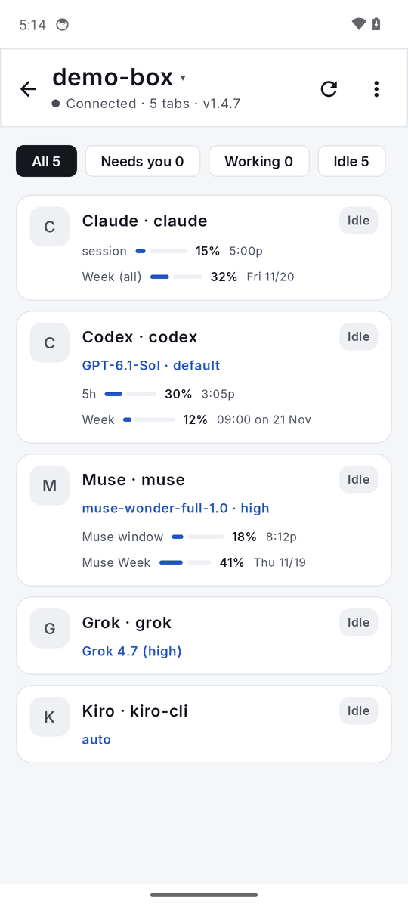
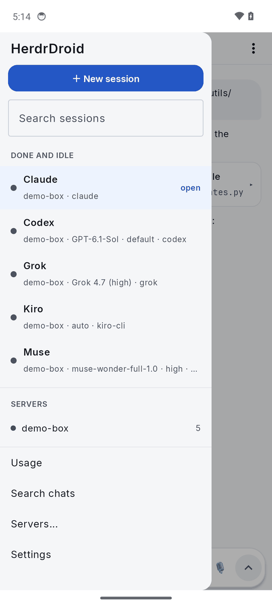
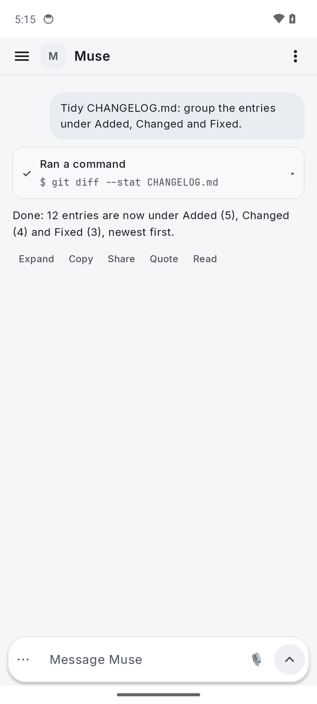
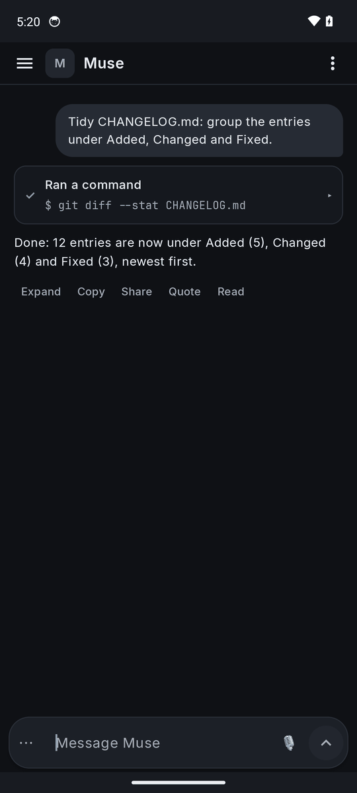
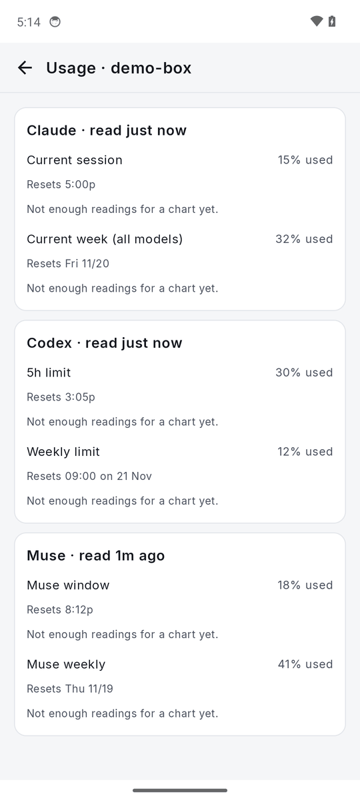
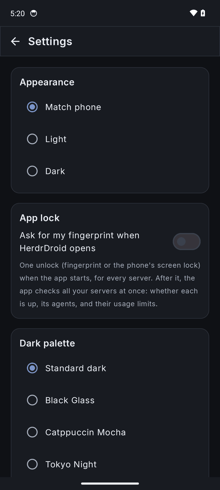

# HerdrDroid

HerdrDroid is an Android app for working with the coding agents in a [herdr](https://github.com/herdrdev/herdr) session from your phone. herdr runs several terminal agents (Claude Code, Codex, Grok, Copilot CLI and others) side by side on one computer; HerdrDroid lets you read what each one is doing, answer its questions, and send it work while you are away from that computer.

The app signs in to the computer over SSH, the way you would from a laptop, and every tap becomes one `herdr` command there. Nothing is installed on the computer and no new network port is opened, because the app uses the SSH server that is already running. Your chats, settings and keys stay on the phone, sealed with keys in the Android Keystore.

HerdrDroid is for people who already run agents under herdr on a computer they can reach (at home, at work, or in the cloud) and want to keep those agents moving from a phone: approving a command, answering a question, or checking whether a long job finished.

> **Experimental software.** HerdrDroid is experimental and provided as is, with no warranty of any kind. It can type into and approve actions in the agents on your computer, so review what you send and use it at your own risk.

## Contents

- [Screenshots](#screenshots)
- [Features](#features)
- [Voice Control and Bluetooth](#voice-control-and-bluetooth)
- [Supported agents](#supported-agents)
- [Requirements](#requirements)
- [Installing](#installing)
- [First setup](#first-setup)
- [Security and privacy](#security-and-privacy)
- [SSH over a WebSocket](#ssh-over-a-websocket)
- [Usage limits](#usage-limits)
- [How the app treats the panes](#how-the-app-treats-the-panes)
- [How each action maps to herdr](#how-each-action-maps-to-herdr)
- [Building from source](#building-from-source)
- [Tests](#tests)
- [Troubleshooting](#troubleshooting)
- [Version history](#version-history)
- [Project layout](#project-layout)
- [Contributing](#contributing)
- [License](#license)

## Screenshots

Taken on an Android emulator against a demo computer ("demo-box") running herdr with stand-in agents. Every name, path, chat and usage figure in them is made up. Each screen is shown in the light and the dark theme; the app follows the phone's setting, or you can pick one in Settings.

### Servers and agents

| | Light | Dark |
|---|---|---|
| **Servers** |  |  |
| **Agents on one computer, with each one's model and usage limits** |  |  |
| **The session drawer** |  |  |

### Chats

| | Light | Dark |
|---|---|---|
| **A Claude Code chat, read from its own log** |  |  |
| **A Muse Code chat** |  |  |

### Questions and approvals

| | Light | Dark |
|---|---|---|
| **An approval card: each button says which keys it sends, and a standing permission carries a caution** |  |  |

### Usage and settings

| | Light | Dark |
|---|---|---|
| **Usage limits for every agent on the computer** |  |  |
| **Settings** |  |  |

## Features

### Servers and agents

- **Servers.** You add each computer yourself: a name, its address, its SSH port, your username, and the command that runs herdr there (for example `herdr` or `~/.local/bin/herdr`). The app works with the herdr terminal app and with herdr-core (the Herdr App); it uses whichever is running and asks once if both are.
- **All agents at a glance.** Every herdr pane is a card with its agent and folder, its status (Needs you, Working, Done, Idle), the model it runs, its usage, and the last line it printed. A pane waiting on you has an orange border and sorts to the top. A drawer lists every agent on every saved server, grouped by status, so you can jump between them.
- **Starting and closing sessions.** **New session** starts an agent in a folder you choose on the computer; **Close session** ends one.

### Talking to an agent

- **Chat view.** For agents that keep a readable session log, the app reads that log and shows the conversation as a chat: your messages, the agent's replies and thinking, and each tool call with its result, diffs and images included. Messages you send stay on screen until the agent's log shows them, with **Resend** and **Dismiss** if one never arrives. A chat can be exported as Markdown.
- **Screen view.** For agents without a readable log, the app turns the terminal screen into a readable page: it rejoins lines the agent wrapped at the terminal's width, keeps tables and boxes in a monospace strip that scrolls sideways, and moves the agent's own input box and status line to a footer.
- **Terminal view.** The exact screen, unwrapped, in a monospace font. It is always one tap away: from the agent's menu, and from **Show terminal** on every question card and error banner. When the app can't read a pane's screen, the terminal view says why rather than showing "Loading" for ever.
- **Keys.** Two rows of keys that always fit the screen: Ctrl, Alt and the arrows, then Esc, Tab, Backspace, Enter and Ctrl+C (after you confirm). Ctrl and Alt work like a phone terminal's extra keys: tap one and it applies to the next key; long-press it to hold it.
- **Never typing into a busy pane.** Before a message goes into a pane, the app reads the pane's input line. If text is already typed there at the computer, or someone typed in the last 4 seconds, or the screen can't be read, the message is held. The app then checks again every 2 seconds and sends it as soon as the line is clear, so you see nothing unusual unless it fails: if the line is still not clear after 2 minutes, or the send itself fails, the message is marked "Not seen", the app says why, and **Resend** sends it anyway. While it waits, the chat says "Sends when the input line at the computer is clear", with **Cancel**. An agent's placeholder in an empty input line (the grey text that is there for you to type over, such as Claude Code's "Press up to edit queued messages" or any of Codex's suggestions) is not typing: the app reads the line with its colours and treats text drawn entirely faint or grey as empty (italic too, for Hermes's examples). Anything in normal type is typing, including typing followed by a dim suggestion. Where the colours can't be read, only the known hints count (Claude Code's, Codex's "Ask Codex to do anything", Kiro's "ask a question or describe a task ↵"), as the whole line for the pane's own agent. A held message is never typed into a question, or while a usage check runs in that pane.
- **A draft in the pane.** When text is typed in an agent's input box at the computer but not sent, the chat shows it in a **Draft in the pane** card under the conversation, in a monospace box that scrolls when the draft is long, with all of its lines. Messages from the app wait while it is there, and their note points to the card. **Send draft** presses Enter once to send the draft as it is; **Clear draft** asks first, then empties the box with Backspace (a few first, read back, then the rest) and never presses Enter. While a command or suggestion list shows under the box, neither is offered. Before either, the app reads the pane again and goes ahead only if the same agent session is in it, no question is open, the pane is at the bottom of its scrollback, and the draft is exactly the text shown. It says the draft was sent or cleared only when a new read shows the box empty, and it never tries again on its own. Claude Code's box is found also when its top rule carries the session's title and a list of its background agents shows under it (Claude Code 2.1.329). Clear draft is offered for Claude Code, Codex, Hermes and Grok. When the app can't see where a draft ends, the card shows what it read with **Show terminal** and no buttons that type.
- **Reading fonts and size.** Choose Inter, Source Serif or JetBrains Mono for replies, and pinch to change the text size, which is remembered for each server.

### Questions

- **Question cards.** When an agent asks something (a numbered menu, a `(y/n)` prompt, Claude's multi-question dialog, Kiro's unnumbered approval menu, Grok's privacy dialog), the app shows it as a card with one button per answer. Each button says which keys it sends: arrows and Enter for a highlighted menu, the option's own key for Codex ("(y)", "(a)"), Esc for a "(esc)" option. Checkbox lists, "Other" or "Type something" options, and menus of up to 20 options are handled. An option that grants standing permission ("don't ask again", "always allow") carries a caution.
- **Muse Code's quota warning.** When Muse Code says "You're using your quota fast" and offers Switch to Spark, Turn on contributor mode, Both, or Keep going, the chat shows it as a card with each option as a button and each option's note (including that Both and contributor mode let session content be used for product improvement). **Keep going** closes the warning and changes nothing. Muse marks the highlighted option only by colour, so before an answer goes the app reads the pane with its colours, checks that the warning is unchanged, then moves the highlight with the arrow keys and presses Enter. If it can't tell which option is highlighted, it sends nothing and says so. This warning is answered only from the chat, not from an alert or by voice.
- **Never an empty card.** When the screen looks like a question but no parser can read its options, the card shows that part of the screen with generic keys. When the screen can't be read at all, the card says so. Every card has **Show terminal**.
- **Errors are not questions.** When an agent stops on an error (a rate limit, a usage limit or quota, out of credits, a provider or server error, an overloaded model, a lost connection, an expired sign-in, a full context window or a failed compaction, or a crash), the pane shows a banner naming the error, with **Show terminal**, instead of a card. herdr's "blocked" status alone, with nothing on screen that asks, makes no card.
- **Question history.** Every question an agent asks stays in that agent's chat as plain text: the question, the options, how it ended ("answered", "answered elsewhere", "dismissed"), and your answer. Each question sits where it happened in the chat, by the times in the agent's own log (corrected for any difference between the phone's clock and the computer's), so newer messages appear below it. Where a log has no times (Grok's), the app uses its own clock: when it first saw each message. A message the app first sees after a question was answered always goes below that question. An agent with no readable log (Antigravity, or a plain shell) keeps the screen just before each question, so its view is a history of earlier screens with each question between them, and the live screen last.

### Alerts and Watching

- **Watching.** With **Tell me when an agent needs me** on, the app keeps watching your agents in the background (a quiet "Watching" notification shows) and alerts you when one starts waiting on a question. It can watch your other saved servers too.
- **Answering from the alert.** A question's alert has its first two options and Esc. A tapped button turns the alert into "Sending your answer", then "Answered". A button answers only if the same question, with the same option, is still on screen; otherwise the alert says to open the app.
- **Error alerts.** An agent that stops on an error sends one "stopped on an error" alert, with no answer buttons, once per change of state.

### Usage, files and work

- **More in each agent's menu.** Switch the agent's model, search and export conversations, read a reply aloud, dictate a message, and share text or files into HerdrDroid from other apps.

- **Usage limits.** Each agent's card shows its tightest usage limit and when it resets, and **Usage** lists every limit. See [Usage limits](#usage-limits) for how the app reads them without spending a model call.
- **Files.** Browse the files in an agent's folder, open text and images, and send a file from the phone to the computer for the agent to read.
- **What runs under an agent.** **Running underneath** lists the processes an agent started, with their output, and can stop one.
- **Debug bundle.** **Copy debug bundle** and **Share debug bundle** put one pane's state (the app and agent versions, the parser's decision on the last screen, recent diagnostic lines) on the phone's clipboard or share sheet, with API keys, tokens, passwords, web addresses and e-mail addresses taken out.

### Staying connected

When the phone sleeps or the app goes to the background, Android drops the SSH socket. The app opens a fresh connection when it comes back, and until then the top bar says **Reconnecting** in grey. Previews and reads that fail because of a dropped connection are retried quietly, and keys, messages and answers you send while it reconnects wait in a queue and go out in order. A banner appears only for something you have to act on: a server still unreachable after 15 seconds, a refused sign-in, a changed host key, or a herdr command that failed.

## Agent proposals across servers

On the phone, enable **Settings → Agent cross-server messaging** (off by default). Open the source agent's Herdr TUI pane, then choose **More → Listen for agent proposal**. Tap **Copy proposal instructions** and provide those instructions to that agent in its normal chat; let the agent decide what to propose. Keep the pane open at the live bottom. The app listens for one proposal for up to five minutes, using its existing pane reads. It needs no host installation or changes to Herdr, SSH, or agent configuration.

For example, an agent that wants to propose `The build is ready for review.` can render this plain fenced block, substituting the phone's one-use code on both marker lines:

```text
HDMSG1 1234567890abcdef1234567890abcdef
HD> VGhlIGJ1aWxkIGlzIHJlYWR5IGZvciByZXZpZXcu
HDEND 1234567890abcdef1234567890abcdef
```

The body is standard padded Base64 of the literal UTF-8 message (up to 1,024 bytes), split into lines of at most 40 encoded characters with an `HD> ` prefix. Keep the marker lines intact. It carries no destination, command, or authorization. A matching code ties output to a listen window; it does **not** authenticate an agent or exclude another process that can write to that pane. Treat the proposal as untrusted and never include secrets. Ordinary terminal and chat retention still applies to what the agent prints.

Tap **Review agent proposal**, read the exact decoded text, choose an idle agent on another server from connected Fleet destinations (**Watch my other servers too**), and separately tap **Send message**. Leaving the pane, backgrounding or locking the app, disabling the setting, or expiry cancels pending approval. The app never sends a proposal over voice, from a notification, in the background, or by typing into the destination terminal. A send is one attempt; if delivery is uncertain, check the destination before proposing again.

## Voice Control and Bluetooth

On Android 12 or later, open **Settings → Voice** and choose **Phone speaker and mic** or **Bluetooth speakers and mic**. For a car, enable **Phone calls** in the Android Bluetooth settings for that connection. Media audio alone cannot supply the car microphone. Select Bluetooth, then try **Read aloud** or start **hands-free** and say “Hey Herdr.” The car may display this audio as a call. HerdrDroid releases the route when speaking and listening end. If Android cannot connect the selected route, the app shows an error. Android's separate system dictation uses the system recognizer's route.

Voice Control is off by default. Turn it on in **Settings → Voice**. Tap the mic for ordinary dictation into the composer. Hold the mic to open Android’s voice command prompt, or choose **Voice command** from the menu. Dictation keeps its existing draft and send controls.

Commands include “Switch to Codex on Laptop,” “Switch to Laptop,” “Read the latest reply,” and “Repeat that.” Use the names from your drawer. If several panes match, include the server name. Server switches use saved connections and still respect sign-in requirements.

Say “List questions” to hear questions and approvals verified on connected panes, including Fleet connections. The scan is bounded and says when it couldn't verify every pane. Switch to the pane you want, then say “Read question” to hear the card and its numbered options. You can also go straight to “Answer option one” (or “Option 1”) in the open chat without listing or reading first. Listen to the full destination, card context and choice, then say “Confirm answer” or “Cancel answer.” For approvals, “Read approval,” “Confirm approval,” and “Cancel approval” are aliases.

Voice can pick supported single-choice answers, one-time approvals, and denials. Use the phone for standing permission, typed answers, multi-question or multi-select dialogs, and anything incomplete or ambiguous. Confirmation expires 45 seconds after readback. HerdrDroid rechecks the live card and its pane, connection, and occupant before sending; it never queues a voice answer.

To send directly to another server, say “Send a message to Codex on Laptop,” replacing **Codex** and **Laptop** with the pane and server names in the drawer. Say “Dictate check the build,” listen to the full destination and message readback, then say “Confirm message” or “Cancel message.” Each hands-free step needs its own “Hey Herdr” and tone. A voice draft expires after 45 seconds of waiting for the next step and is invalidated by navigation or a destination connection change. For a pane on the current server, open that pane first.

On the phone, long-press a pane on another server in the session drawer, choose **Send prompt…**, and check the named destination before tapping **Send prompt**. Neither direct-send path switches chats. Direct sends require an already connected Fleet watcher for the destination (with **Watch my other servers too** enabled and sign-in available without a prompt), an identifiable pane on the Herdr TUI backend, and a clear, idle composer. The app does not force, queue, reconnect, or retry a direct send. If delivery can't be confirmed, check the destination chat before sending again.

While hands-free is on, new completed assistant text in the selected chat is read aloud once. Old chat history, your messages, and other panes aren't announced. Stop hands-free before discussing or opening anything you don't want spoken aloud.

### Say “Hey Herdr” with the screen locked

1. While parked, pair the phone to the car, enable Phone calls for the car in Android Bluetooth settings, and choose **Bluetooth speakers and mic** in HerdrDroid.
2. With HerdrDroid open, choose **Settings → Voice → Start hands-free**, then return to the chat you want to hear. Allow microphone access and notifications so the session can show its **Stop** action. The first start downloads a roughly 40 MB English recognition model from Alpha Cephei and verifies its SHA-256 before use. Download it over Wi-Fi if you prefer.
3. Wait for **Listening for Hey Herdr** in the notification. Lock the phone and put it in your pocket. Say “Hey Herdr,” wait for the tone, then say one command. To confirm an answer, wait for the readback to finish, then say “Hey Herdr,” wait for the tone, and say “confirm answer.”
4. Stop the session from its notification or **Settings → Voice**. It also stops after an hour, when you remove the app from Recents, or when the service ends. Start it again with the app open.

Hands-free recognition runs locally with [Vosk](https://alphacephei.com/vosk/) and the Apache 2.0 [English model](https://alphacephei.com/vosk/models). Android’s short dictation and voice command prompts use the phone’s configured recognition service. You can leave HerdrDroid’s app lock on: unlock the app normally, then explicitly start hands-free. While that session runs, HerdrDroid defers repeat app-unlock prompts, including when you return from the background. Stopping restores normal app-lock checks; closing the app or restarting its process ends the session. This does not unlock Android or extend the Keystore’s four-hour fingerprint window. If Android requires authentication to open saved passwords, keys or kept chats, unlock normally to access them. Bluetooth volume, microphone pickup and interruptions depend on your phone and car. Pause the session before switching audio devices if commands stop coming through.

### Try the 2.0 test build

Install the signed APK over version 1.4.11 without uninstalling it, then check that your saved servers, touch controls and typed replies still work. Test Voice Control indoors first. Switch between two panes and check that chat follows the selection. Tap one choice on a harmless question and look for **Sending…**. Check that it sends just once. Open the drawer for an OpenCode and a Kiro pane and compare the model label with each pane’s footer. Kiro shows **Auto** if that is what the CLI reports.

When an agent is working, tap **Steer** to send now. Tap the arrow next to it for **Send when idle**, which keeps the draft in HerdrDroid’s queue. The menu keeps the composer’s keyboard state. A message in that queue has its own **Send immediately** and **Cancel** actions. Sending early still checks for a question or someone typing in the pane. Once an agent has accepted a message into its own queue, it controls when to read it.

For the parked Bluetooth test, hear a reply through the stereo, lock the Pixel with hands-free active, and try switching panes and reading a question. Try a harmless answer, cancel it once, then confirm a fresh one. Test **Stop** and a Bluetooth reconnect. If speech comes from the phone or the wake phrase goes unheard, note the active Bluetooth source, whether the phone was locked, and the hands-free notification state.

## Supported agents

herdr reports which agent runs in each pane. HerdrDroid supports these:

| Agent | Chat from its log | Question cards | Usage limits | Model shown |
|---|---|---|---|---|
| Claude Code | yes | yes, including the multi-question dialog | `/usage` | from `/model` |
| Codex | yes | yes, with each option's own key | `/status` | from its footer |
| Grok | yes | yes, including its privacy dialog | `/usage` | from its footer |
| GitHub Copilot CLI | yes | yes | `/usage` | from its footer |
| Antigravity (agy) | no (its log has no published format) | yes | `/usage` | from its footer |
| Kiro CLI | yes | yes, including its unnumbered approval menu | no | from its footer |
| Mistral Vibe | yes | yes | no | from its footer |
| pi | yes | yes | no (none to read) | from its footer |
| Oh My Pi (omp) | yes | yes | no | from its footer |
| OpenCode | yes | yes | no (none to read) | from its footer |
| Hermes | yes, plus a chat screen through its gateway | yes | `/usage` | from its footer |
| Muse Code (Meta) | yes | yes, including its command approval with each option's own key ("y", "p", Esc); a command with several stages asks once per stage | `muse usage --json` (window and weekly allowance; nothing typed into the pane) | from its footer, with its effort |

### Question cards

Every question and approval card the supported agents can show is in the screen library and checked on every build: its options, which keys answer each one, the caution on options that grant standing permission, and Esc for refusals. The full list, card by card, is in [docs/question-cards.md](docs/question-cards.md).

| Agent | Cards checked | Captured live | From the program |
|---|---|---|---|
| Claude Code | 15 | 2 | 13 |
| Codex | 10 | 2 | 8 |
| Grok | 9 | 4 | 5 |
| GitHub Copilot CLI | 6 | 1 | 5 |
| Antigravity | 1 | 0 | 1 |
| Kiro CLI | 3 | 1 | 2 |
| Mistral Vibe | 3 | 1 | 2 |
| pi | 2 | 0 | 2 |
| Oh My Pi | 2 | 0 | 2 |
| OpenCode | 5 | 0 | 5 |
| Hermes | 3 | 0 | 3 |
| Muse Code | 4 | 2 | 2 |

"Captured live" cards were read from an agent's own pane; the others were built from the exact text in the agent's own program, with demo content, and have not yet been seen live.

Every agent gets the error banner, the terminal view, the keys and the alerts. A pane running a plain shell or an agent the app doesn't know is shown as a screen, with the terminal view and the keys.

## Requirements

- **A phone** with Android 8.0 or later. The fingerprint window needs a secure screen lock; Android 11 or later accepts the screen lock as well as a strong fingerprint or face unlock.
- **A computer running herdr**, reachable from the phone over SSH: on your own network, through a VPN, or through a public address. A computer that can only be reached over HTTPS can be reached with SSH over a WebSocket (see [SSH over a WebSocket](#ssh-over-a-websocket)).
- **An account on that computer** that can run `herdr`, with a password, an SSH key, or both.
- **python3 on the computer** for the chat view, the file browser and the process list. The app sends its small reader script over SSH each time; nothing is installed.

No server-side software is needed beyond herdr, SSH and python3.

## Installing

HerdrDroid is installed from an APK rather than from an app store. Each release is in the `release/` folder of this repository as `HerdrDroid-<version>.apk`.

1. Download the newest `release/HerdrDroid-<version>.apk` to the phone.
2. Open it, and allow your browser or file manager to install apps when Android asks.
3. Open HerdrDroid.

To upgrade, install the newer APK over the old one; your servers, chats and settings stay. Every release is signed with the same key, which is what lets a new version install over an old one. A build signed with any other key (for example one you build yourself with a key of your own) can't install over a release; Android asks you to uninstall first, which removes the app's data.

### Updates

From 2.1.4, HerdrDroid can update itself. In **Settings**, under **Updates**, **Check for updates daily** (on by default) asks GitHub once a day, when the app opens on a network that isn't metered, whether a newer release is out; **Check for updates now** asks right away. When one is out, the app shows "HerdrDroid X.Y.Z is available" with **Update** and **Not now** (Not now skips that version until the next one). **Update** downloads the release APK into the app's cache, checks that it is HerdrDroid, newer than the installed build, the size the release lists, and signed with the same key as the installed app, and then opens Android's installer, where you confirm it. The first time, Android asks you to allow HerdrDroid to install apps. The check sends only a generic `HerdrDroid/<version>` User-Agent, nothing about you or your servers.

## First setup

1. **Add a server.** Tap **Add server** (or **Find on this network** to look for SSH servers on your Wi-Fi) and fill in a name (optional), the address, the SSH port (22 by default), your username, and the herdr command. Leave **herdr on that computer** on **Automatic** unless you know which herdr runs there. Use the full path to herdr (for example `/home/user/.local/bin/herdr`) if it is not on the PATH of a non-interactive SSH session.
2. **Trust the host key.** The first time you connect, the app shows the server's SHA-256 host key fingerprint and asks you to confirm it. Check it on the computer with `ssh-keyscan localhost | ssh-keygen -lf -`. After that, the app refuses to connect if the fingerprint changes.
3. **Sign in.** Type your password and choose whether to remember it on the phone (encrypted). To sign in with a key instead, edit the server, turn on **Use an SSH key**, and either make a key on the phone or import a key file. A key made on the phone shows its `authorized_keys` line with **Copy** and **Share**; add that line to `~/.ssh/authorized_keys` for your user on the computer. With a key and a saved password, the app offers the key first and the password second.
4. **Turn on alerts (optional).** In **Settings**, turn on **Tell me when an agent needs me** and allow notifications when Android asks.

## Security and privacy

- **What is kept where.** Servers, settings, saved passwords, imported keys, chats and question history are kept on the phone, in the app's private storage. Saved passwords, imported key files and their passphrases are encrypted with an AES key that never leaves the Android Keystore. Kept chats and question histories are sealed the same way, and each file is bound to its server and pane, so a file in another pane's place won't open.
- **Keys made on the phone** are ECDSA P-256 keys inside the Android Keystore: they can sign but can never be read or copied out.
- **The fingerprint window.** The Keystore keys for saved secrets and kept chats can be used only for 4 hours after you prove who you are (a strong fingerprint or face unlock, or the screen lock). Unlocking the app counts, and so does unlocking the phone. After the window, the app asks you to unlock when it opens, and alerts say "Unlock HerdrDroid to read" instead of the question.
- **Host key pinning.** A server's host key is pinned the first time you connect, and a changed key stops the connection.
- **No data is lost to a locked or damaged file.** A kept file that can't be opened now (the phone locked, a read error) is left where it is; one that is damaged for certain is moved to an `unreadable` folder, not deleted. Moving data to new keys or new file names writes the new copy, reads it back, and only then removes the old one.
- **What the app writes on the computer.** Three things, all because you asked for them: a file you send from the phone goes to `~/.herdrdroid/inbox` (or a folder you pick), so the agent can read it; **Recycle** moves a file to `~/scratch/herdrdroid-recycled-<date>` instead of deleting it; and starting an agent in a new folder creates that folder. Nothing else is written there, and the app's reader script runs from memory.
- **What a login can do.** A password login is a full shell for that user. The app only runs `herdr` commands and its reader, but anyone who can use your unlocked phone and this app can type into every pane. Keep the phone locked, and prefer servers on your own network or a VPN.
- **No telemetry.** The app talks only to the servers you add, and to GitHub for the update check (see [Updates](#updates)), which sends nothing about you or your servers.

## SSH over a WebSocket

Some computers can be reached only over HTTPS: no SSH port answers from outside, but a web address does. For those, set a server's **Connect through** to **SSH over WebSocket** and give it a `wss://` address. The app carries its ordinary SSH connection inside that WebSocket. Everything else is the same: the pinned host key, signing in with the phone's key, and the herdr commands.

You run a small bridge on the computer that passes WebSocket bytes to its own SSH server. The bridge holds no credential and does no authentication of its own; SSH's handshake (the host key you pin and the key on your phone) is the only gate.

### What the bridge has to do

- **Accept a plain WebSocket upgrade over HTTP/1.1** at its address: RFC 6455, no subprotocol, no special headers, no query string, no HTTP authentication. The app always uses HTTP/1.1. If the bridge sits behind a proxy or CDN, that path must pass an HTTP/1.1 `Upgrade: websocket` through. A front end that answers over HTTP/2 instead replies `200` and never upgrades, and the app reports "The WebSocket upgrade was refused (HTTP 200)".
- **Carry the raw SSH byte stream in binary frames**, both ways, in order. Frame boundaries mean nothing; the bridge may split or join bytes however it likes, but must never drop or reorder them. Text frames are not allowed.
- **Connect each WebSocket to the SSH server** (usually `127.0.0.1:22`), and close one side when the other closes.
- **Answer pings.** The app pings every 20 seconds and SSH sends keep-alives every 15, so an idle connection stays open.
- **Use TLS** (`wss://`) for anything reachable from outside, either in the bridge itself or in a reverse proxy in front of it.

### The SSH server behind it

Because the address is public, set the SSH server to keys only:

```
# /etc/ssh/sshd_config.d/00-keys-only.conf
PasswordAuthentication no
KbdInteractiveAuthentication no
PubkeyAuthentication yes
```

Then `sudo sshd -t && sudo systemctl reload ssh`. Add the phone's key line (the server's settings in the app, **Copy** or **Share**) to `~/.ssh/authorized_keys` for the user the app signs in as, with `~/.ssh` at mode 700 and the file at 600. If sshd runs with `UsePAM no` and the account was made without a password, unlock it without giving it a usable one (`sudo usermod -p '*' <user>`); otherwise sshd refuses the locked account even with a valid key.

Read the host key fingerprint on the computer, to type or paste into the app:

```bash
ssh-keygen -lf /etc/ssh/ssh_host_ed25519_key.pub     # prints SHA256:...
```

### Running the bridge

Either tool works; keep it listening on localhost and put TLS in front.

[websockify](https://github.com/novnc/websockify) (packaged in Debian and Ubuntu as `websockify`):

```bash
websockify 127.0.0.1:8080 127.0.0.1:22
```

[websocat](https://github.com/vi/websocat):

```bash
websocat --binary -E ws-l:127.0.0.1:8080 tcp:127.0.0.1:22
```

Run it under systemd (or your container's supervisor) so it starts again after a restart.

A TLS front end with [Caddy](https://caddyserver.com/), which gets a certificate and passes WebSocket upgrades by itself:

```
ssh.example.org {
    reverse_proxy 127.0.0.1:8080
}
```

Or with nginx (inside an existing `server { listen 443 ssl; ... }` block):

```
location / {
    proxy_pass http://127.0.0.1:8080;
    proxy_http_version 1.1;
    proxy_set_header Upgrade $http_upgrade;
    proxy_set_header Connection "upgrade";
    proxy_read_timeout 1h;
    proxy_send_timeout 1h;
}
```

A hosting platform that publishes a container port on an HTTPS address works the same way: publish the bridge's port, and the platform's address is the `wss://` address.

### Checking it from a computer

With `websocat` installed on a laptop, OpenSSH can go through the bridge exactly as the app does:

```bash
ssh -o ProxyCommand="websocat --binary wss://ssh.example.org/" <user>@bridge
```

The name after `@` is only a label here; the connection goes wherever the address points. If that signs in and `herdr --version` runs, the app will connect too. Use the full path to herdr in the app's settings (for example `/home/<user>/.local/bin/herdr`), since a non-interactive SSH command doesn't read `~/.bashrc`.

### In the app

Edit the server, choose **SSH over WebSocket**, and fill in the address (it starts with `wss://`), the username, the herdr command and the host key fingerprint. Then make or import a key and add its line on the computer. The connection is closed whenever the app goes to the background, so a host that sleeps when idle can sleep. If it doesn't answer at first, the app retries for about 30 seconds ("it may be waking up"), and **Cancel** stops that. Settings → **Diagnostics** shows each step of a connection (the upgrade, the first bytes each way, the SSH key exchange) without the address, keys or passwords.

`tools/ws-test-server/` holds a throwaway sshd behind websockify that the end-to-end test uses; its Dockerfile shows a complete working setup.


## Usage limits

**Usage** lists limits the app can read without typing into a pane: CLI reports (Oh My Pi and Muse) and a visible footer (Mistral Vibe). Readings are shared across panes of the same agent on a server. Agents that require typing a command into a pane do not get new automatic readings; the app won't submit a command or start a session to check usage. The usage setting turns off automatic checks and hides usage readings.

Claude Code, Grok, Antigravity and Kiro open modal usage panels. The app skips automatic checks for these profiles because Herdr cannot atomically verify and close a panel. It never sends Escape in the background to recover one. In the agent view, **Dismiss usage** appears for recognized Claude Code and Kiro panels when the live pane and its occupant can be verified. The button checks the screen again and sends one Escape, without retrying or queuing the key. If the panel is unfamiliar, the pane is scrolled back, or the server cannot verify the pane, use **Show terminal** to inspect the screen and use the terminal keys deliberately.

## How the app treats the panes

- **Reading moves nothing.** Every screen and every bit of scrollback is read with `herdr pane read`, so no scroll or copy-mode key is ever sent just to read. Screen reads run on their own SSH channel, so a long command never holds them up.
- **A pane's size is never changed.** The app runs `herdr` commands over plain SSH command channels, never as a client attached to the session and never with a terminal of its own, so herdr never reflows a pane to the phone's width.
- **Fewer polls when you are not looking.** While the app is behind, the agent screen stops reading; the watcher waits on herdr for any agent to change state instead of asking every few seconds, and everything slows down further with the screen off.
- **Agent versions.** On connecting, the app runs each agent program's own `--version` once (nothing is typed into any pane), so a question card that changes shape in a new version can get its own rule.

## How each action maps to herdr

| In the app | On the computer |
|---|---|
| All agents | `herdr pane list` |
| A card's last line | `herdr pane read <pane> --source recent --lines 12` |
| An agent's screen | `herdr pane read <pane> --source recent --lines 200` |
| Send a message to an agent | `herdr agent prompt <pane> <text>` |
| Send a message to another pane | `herdr pane send-text <pane> <text>`, then `herdr pane send-keys <pane> enter` |
| Keys | `herdr pane send-keys <pane> esc` (or `tab`, `up`, `ctrl+c`, `ctrl+r`, `alt+b`, ...) |
| Answer buttons | `herdr pane send-keys` with the arrows and Enter, the option's own key, or Esc |
| Waiting for a change (Watching) | `herdr agent wait <pane> --until <state>` |
| An automatic usage check | Agent CLI report or `herdr pane read <pane> --source visible`; no pane input |
| The chat view, files, processes | `python3` reading the agent's own logs, with the reader script sent over SSH |

Every argument is single-quoted for the remote shell, so message text is passed as typed.

## Building from source

The build needs JDK 17, the Android SDK (platform 34, build-tools 34.0.0) and Gradle 8.9. `build-in-docker.sh` does the whole build in a throwaway `eclipse-temurin:17-jdk` container, keeping the SDK and Gradle caches in a `.cache` folder beside the source:

```bash
bash build-in-docker.sh /path/to/work-folder
```

`<work-folder>/src` holds this repository. The build runs the unit tests first, then writes the signed APK to `<work-folder>/out/HerdrDroid.apk`.

**The signing key.** A release is signed with the project's sideload key, and every build must use that same key, or the APK won't install over an existing one. The key never lives in the source tree: `build-in-docker.sh` reads it from a separate folder (by default `~/Documents/herdrdroid-signing/`, or the folder named by `HD_SIGNING_DIR`) holding `herdrdroid-sideload.jks` and `signing.properties` (with the store password, key alias and key password). It mounts that folder read-only into the build container and points Gradle at it with `HD_KEYSTORE_DIR`. The script stops when the key is missing; it never makes a new one. CI writes the key into `keystore/` from the repository's secrets (`keystore/push-signing-secrets.sh`). Both key files are ignored by git.

If you build for yourself without the project's key, use your own key (a standard Android keystore in the same folder layout). Your build will then install only on a phone without the released app, or after uninstalling it.

## Tests

- **Unit tests** (JUnit, with Robolectric for the Android parts) run in every build: the question parsers against real screens from every agent, the chat view, the usage parsers, the key migration and the kept-chat store interrupted at every step, the notification answer checks, SSH over a WebSocket against a local server, and more. `./gradlew testDebugUnitTest` runs them.
- **The screen library.** `app/src/test/resources/screens/<agent>/<version>/` holds agents' screens: question cards, error screens and fallback cases, each with an `.expect` file that says what the parsers must make of it (a card with these options, the fallback card, no card, or an error banner naming these errors). Each fixture says where it came from: captured live, taken from the agent program's own strings, or modelled on the agent's style. A new capture with no `.expect` file must parse as a real card if it looks like a question; `ScreenLibraryTest` lists every screen that doesn't, so a card that stops parsing after an agent update shows up.
- **Reader tests.** `tools/transcript-tests/` tests the log readers in `transcript.py` (for example Kiro's and Vibe's) on synthetic session stores: `python3 -I tools/transcript-tests/test_kiro_reader.py`. Muse Code's is `test_muse_reader.py`.
- **End-to-end.** `tools/ws-test-server/` is a throwaway sshd behind a WebSocket bridge for the WebSocket test, and `tools/hc-e2e/` checks the herdr-core backend.
- **Emulator checks.** Each release is also checked by hand-scripted runs in an Android emulator against a herdr host whose panes run small stand-in agents that draw each agent's cards, errors and logs: upgrading over the previous release with saved data, answering cards and alerts, the terminal view, and the error banners.

## Troubleshooting

- **"The host key changed".** The server's SSH host key is no longer the one you confirmed. If you reinstalled the server or changed its keys on purpose, edit the server in the app and confirm the new fingerprint; otherwise, don't connect.
- **herdr isn't found.** A non-interactive SSH session may not read your shell's startup files. Put the full path to herdr in the server's **herdr command** (for example `/home/user/.local/bin/herdr`).
- **No chat view, only the screen.** The chat view needs `python3` on the computer and an agent whose log the app can read (see [Supported agents](#supported-agents)). Settings › **Diagnostics** says why a pane's chat view stays off.
- **The screen says it couldn't be read.** The terminal view and the card say why (a dropped connection, a herdr error, an empty screen). The app keeps trying; Diagnostics has the details.
- **A card shows the screen with generic keys.** The app saw a question but couldn't read its options. Use the keys, or **Show terminal** to see exactly what the agent shows. **Copy debug bundle** captures what the parser saw, with secrets taken out, for a bug report.
- **An error banner won't go away.** It reflects what is on the agent's screen. Deal with the error at the agent (wait out a rate limit, sign in again, start a new session), and the banner goes when the screen changes.
- **"Unlock HerdrDroid to read".** The 4-hour fingerprint window has passed. Open the app and unlock it.
- **Alerts don't come.** Check that **Tell me when an agent needs me** is on, that HerdrDroid may post notifications, and that Android's battery settings let it run in the background. A server that needs a saved password the app can't use (the window has passed) sends one "isn't being watched" notice.
- **The APK won't install over the old app.** It was signed with a different key. See [Installing](#installing).

## Version history

- **2.1.4.** A Grok permission question now shows its command in the right order on the question card, in the alert and in chat, without the "┆" and "│" gutters or the "·" wrap marks, whichever box Grok draws around it. Each command line is a line of its own: a row that Grok wrapped joins the row above it, and the others stay separate. The card and chat show the command in a monospace block, and the alert shows the question and then the command on its own lines. A real "|" pipe and a "\n" inside quotes stay as typed. An alert posted by 2.1.3 for such a question no longer answers it from its buttons; open the question card instead. HerdrDroid now closes a usage screen it opened (a /usage you send to Grok, Claude, Kiro or Antigravity) with Esc when you leave it, checks that it closed, opens it only on an idle agent with an empty input box, and types nothing into a pane while a usage screen is open there. Where a question offers both "Type something." (or Oh My Pi's "Other (type your own)") and "Chat about this", the card and the alert show one "Type your answer" option that types your answer into the question, and "Chat about this" stays in Terminal. A /btw side question you send to Claude from HerdrDroid no longer leaves Claude's answer panel open: the app waits for the whole answer, shows the question and the answer in the chat under a small "btw" label, then closes the panel and checks that it closed; a /btw panel opened at the computer is shown in the chat too, and closes only when you tap Close. Claude's two-question dialogs with long questions and option notes (such as an "Allow rule" and a "Host key" question) are covered by new captured screens and tests for the card, the alert and answering each question and then Submit. HerdrDroid can now check GitHub for a newer release, daily or from **Check for updates now** in Settings, and install it after checking its signature (see [Updates](#updates)). Every chat message now shows its time, in every pane: Grok's messages take the time Grok showed them (from its session files, or the time it draws at the end of a message's first row, which no longer shows in the text), Kiro's replies take the time their turn ended, and a message with no time of its own (Antigravity's, or history from before an agent kept times) shows when HerdrDroid first saw it, the same after a reload. A pane that shows as needing you now always has a card in chat: Claude's permission questions (a command held by a hook, a helper agent's request, auto mode's unnumbered No and Yes) show as cards whatever herdr reports, and when the app can't read a question at all, the card says so and offers Show terminal. The agent proposal instructions now name the agents on your other connected servers, such as Hermes, so an agent on one server knows which agents the phone can reach, and the review still offers only the idle ones. With cross-server messaging on, "Tell agents about cross-server messaging" (on by default, with a "Tell agents now" button) sends each idle agent one short notice with those instructions and the agents on your other servers, at most once per agent session and change in that list and once an hour, and skips agents at or above the "Skip agents at or above X% of quota" setting (95% by default; 100% never skips; unknown usage is not skipped).
- **2.1.3.** In Grok's chat, a command that Grok wraps over several rows now shows under its title as one command in a code block, without the "┆" gutter or the "·" wrap marks. Commands on separate lines stay on separate lines, and a real "|" pipe in a command stays. Grok's "Context compacted" notice shows as a quiet line instead of a reply. On the server list opened from the drawer, Back and a new back arrow return to the screen you came from (Back on a server's form returns to the list first), and Back leaves the app only when no server is open.
- **2.1.2.** A message held for a pane on one server stays held while you look at another server, and the app tries it again once that server is connected. A problem with a held message (timed out, failed, pane closed) now shows only in the chat of the pane it was for. Each agent in the drawer shows its own model again, instead of the model of another pane on the same computer. **Clear draft** finishes when the draft's remaining text ends at a word boundary, instead of stopping with "Some of the draft is still" in the box. In Claude Code and Hermes chats built from the screen, the text in the input box no longer shows as a sent message, and Claude's mode symbols show as plain marks instead of empty boxes. The agent proposal review lists every eligible destination, with none hidden below the edge of a small scroll box. Grok's chat folds its tool rows and status line into one activity row, shows its header, notices and privacy banner as quiet lines, lays out its approval box with the command and numbered choices, and keeps the model name in the footer. OpenCode 2.3.2's permission dialog shows as a card with Allow once and Reject in the open chat again, instead of only a terminal review. An OpenCode pane with a permission dialog open now raises the needs-you alert and shows the badge in the drawer and the list, even though herdr reports it as done or idle, and sending to it works as before. A needs-you alert now offers the question's own options, including Always allow for OpenCode. Each alert answers only the question that raised it, so an old alert can no longer answer a newer question. OpenCode 2.3.2's question dialog shows as a card in the open chat and raises the needs-you alert. A Kiro box that shows only its "ask a question or describe a task" hint behind the cursor now reads as empty, even when Kiro draws the hint in normal type.
- **2.1.1.** A message held for a pane on one server no longer shows in the chat of a pane with the same name on another server: held, queued and sent messages, drafts and the composer's text now belong to their own server. **Send draft** reads the input box once more just before it presses Enter and stops if the draft changed. **Listen for agent proposal** appears in the menu as soon as the pane's first read finishes, without reopening the menu. When Claude Code moves its session to the background and shows its sessions list, the chat shows a card that says so, with **Return to the session (Esc)**, and keeps the open question in the chat; messages wait instead of starting a new session. In Antigravity's chat, its tool calls, thinking lines and action counts fold into one activity row you can tap for the steps, and its notices, warnings and status bar read as plain text. Question cards show the question first and lay out the rest for the phone, with paragraphs, lists, commands and coloured diffs in their own blocks and each option's note under its label; **Show raw** shows the parser's text. Empty input boxes showing an agent's suggestion text no longer show a draft card. A draft typed in Claude Code's input box now shows a draft card when the box has a session title in its top rule and Claude's agent list below it. Claude's question card follows the tab you moved to at the computer, a Claude question or a backgrounded session waiting for input shows as needing you even on a short screen, and Antigravity's Models & Quota panel shows as one quiet line in Chat.
- **2.0.6.** Chat shows live Hermes clarification questions. Tap a preset answer on a verified single-choice card, or use **Show terminal** for typed answers, multiple selections, batches, or incomplete cards. A timed-out question in the transcript is not an active card.
- **2.0.5.** Hermes token reports no longer show as pending questions. Messages wait if Usage is still on screen without a composer; the app does not send a key to dismiss ordinary output. Claude checkbox cards expose a separate review or submit button when the terminal shows how to proceed. Checking a box does not submit the answers.
- **2.0.0-rc.8.** Choose Phone or Bluetooth for Read aloud and hands-free from the chat mic menu.
- **2.0.0-rc.7.** Phone polling reads passive snapshots and leaves desktop pane scroll positions alone. Usage checks that open panels skip the focused desktop pane.
- **2.0.0-rc.6.** Claude usage panels stay out of question cards. HerdrDroid checks that a usage panel is still open before closing it.
- **2.0.0-rc.5.** OpenCode web-search permission prompts show their choices in a question card. HerdrDroid retries failed question-screen reads automatically. A message held for the input line shows Force send immediately beside Remove.
- **2.0.0-rc.4.** Tap Remove next to an individual message waiting for idle, a connection or a clear input line. Long-press an unsent message to force send it or remove it. While a question card is open, a chat message waits until the agent is ready. Choose the typed answer option on the card to reply to the question.
- **2.0.0-rc.3.** The agent drawer scrolls to the top each time you open it on a phone.
- **2.0.0-rc.2.** Tap Steer to send immediately. Tap its arrow for Send when idle. The menu leaves focus in the composer.
- **2.0.0-rc.1.** Adds voice commands to the composer mic and an optional locked-screen hands-free session. Question buttons show when a choice is sending and suppress repeated taps during delivery. Pane reads ignore results from a previous visit, and OpenCode and Kiro model labels use their current footers when available. Steer opens a send-options menu, and messages queued until idle can be sent early.
- **1.4.11.** A Claude question card shows that question's own options. A message you sent with numbered lines, echoed on Claude's screen, is no longer read as the answer buttons, and on its own it never becomes a card; a question that was answered and scrolled up is not shown as live.
- **1.4.10.** The Hermes card no longer shows its context window as usage. Hermes now separates its footer fields with " · ", so its context gauge ("422K/500K", with a bar and a percentage) was read as a usage limit; a footer with either separator, and any gauge labelled only by tokens over a limit, is skipped.
- **1.4.9.** An answered question card left in an agent's scrollback (Grok's) is no longer shown as a live question: a card must be at the bottom of the screen, with nothing of the agent's own after it. A check of every card each agent can show: OpenCode's and Vibe's side-by-side buttons, Grok's letter-key trust and plan cards, Hermes's bracketed and checkbox rows, pi's arrow highlight, option descriptions in omp's and Kiro's menus, more standing-permission wording, and the coverage list in docs/question-cards.md.
- **1.4.8.** Muse Code's approval cards with two options or a tall command, even with the card's heading off the screen read; when a pane's usual read fails, its visible screen is read instead; **Show terminal** on a question card always switches to the terminal, with a bar that leads back to the question.
- **1.4.7.** Muse Code's command approval card: its options, the highlighted one, the command, and each option's own key; "Always allow in this workspace" carries the standing-permission caution.
- **1.4.6.** Placeholders in an agent's input line are recognised by how they are drawn (faint or grey), for every agent, so Codex's rotating suggestions no longer hold a message; text that merely stays the same between reads no longer counts as someone typing.
- **1.4.5.** Muse Code (Meta): its chat from its session log, its plan allowance from `muse usage --json`, its model and effort from the footer, its commands in the picker, and Ctrl+B to send a command to the background.
- **1.4.4.** A message held because something is typed at the computer is sent by itself once the input line is clear, and reported only if it can't go within 2 minutes; Claude Code's "Press up to edit queued messages" hint (and the other agents' empty-line hints) no longer holds a message.
- **1.4.3.** Answered questions sit in time order in every agent's chat instead of at the bottom.
- **1.4.2.** Codex's edit-approval card shows its question, description, file and keys; no question card is ever empty; **Show terminal** on every card; agent errors (rate limits, quotas, credits, provider and connection errors, expired sign-ins, full context, failed compaction, crashes) show as a banner for every supported agent instead of a card; herdr's stale "blocked" status makes no card; question alerts have one set of buttons that always answer or say why not; the MIT license and this README.
- **1.4.1.** Kiro's chat from its session log; each kept chat bound to its pane, with a safe move from the old file names; a stricter send guard; agent versions read in parallel; fixes from code review.
- **1.4.0.** The fallback card, every answer type (checkboxes, "Other", standing-permission cautions, menus past nine options), never typing into a busy pane, the debug bundle, fewer polls in the background, and version-aware parsers.
- **1.3.x.** Questions kept in the chat history (1.3.0); the 4-hour fingerprint window for saved secrets and chats, and usage checks only on quiet panes (1.3.1); a key migration and chat store that never lose data, however they are interrupted (1.3.2).
- **1.2.x.** Grok's privacy dialog, Claude's multi-question dialog with its steps, question cards for Kiro and Vibe, the readable screen view, and the sealed chat cache kept on the phone.
- **1.1.x.** Agents first, with a drawer across every server; the model of every agent in the drawer; finding servers on the local network; herdr-core (the Herdr App) alongside the terminal herdr, tested end to end.
- **1.0.x.** The model menu, usage alerts and usage history, and the Hermes menu with its conversations.
- **0.7 to 0.9.** Replying from notifications, sharing into the app, searching conversations, git status on cards, edit review, snippets, read aloud and usage charts (0.7); whole questions in the question card with the agent's latest message (0.8); usage checks that never type into the agent you are using, and busy agents shown as working (0.8 and 0.9).
- **0.4 to 0.6.** Alerts, every server at once, files, sending work to agents, history, export and model switching (0.4); SSH over a WebSocket (0.4.2); what runs under an agent, with Stop (0.5); herdr-core support and streamed replies (0.6).
- **0.1 to 0.3.** The first app: servers, the pane list, reading a pane, messages and keys over SSH (0.1); quiet reconnects, dark mode, SSH keys, held modifier keys and usage limits (0.2); chats from the agents' own logs, the Hermes chat, Oh My Pi, and images and files in the chat (0.3).

Each release's APK is in `release/`, and the git history has the details.

## Project layout

| File | What it holds |
|---|---|
| `app/src/main/java/.../ssh/HerdrSsh.kt` | The SSH connection, host key pinning, and the command channels |
| `app/src/main/java/.../ssh/WsBridge.kt` | SSH over a WebSocket: the local relay between the SSH library and the WebSocket |
| `app/src/main/assets/transcript.py` | The reader sent to the computer's python3 for agent logs, history, files and processes |
| `app/src/main/java/.../herdr/Herdr.kt` | The herdr commands, pane parsing, question and error detection, and read-only usage checks |
| `app/src/main/java/.../herdr/Reflow.kt` | Turning a terminal screen into the readable screen view |
| `app/src/main/java/.../herdr/Quota.kt` | Each agent's usage command and the parser for its usage screen |
| `app/src/main/java/.../store/ServerStore.kt` | Saved servers, settings, the Keystore encryption, the key migration, and keys made on the phone |
| `app/src/main/java/.../transcript/` | The chat model, the kept-chat store, and the question history |
| `app/src/main/java/.../notify/Notify.kt` | Alerts, their answer buttons, and the background Watching service |
| `app/src/main/java/.../AppViewModel.kt` | App state, connecting and reconnecting, the send queue, usage checks, and answers |
| `app/src/main/java/.../ui/` | The screens: servers, settings, all agents, one agent, files, and the Hermes chat |
| `app/src/test/` | Unit tests and the screen library |
| `app/src/main/res/font/`, `app/src/main/assets/licenses/` | The bundled fonts (Inter, Source Serif 4, JetBrains Mono) and their SIL Open Font License texts |
| `build-in-docker.sh` | The containerised build |
| `tools/` | Reader tests, the WebSocket test server, and the herdr-core check |

## Contributing

Bug reports and pull requests are welcome. For a question card or an error the app reads wrongly, the most useful report has the agent, its version, and the debug bundle (**Copy debug bundle** in the agent's menu), which takes out keys, tokens, passwords, web addresses and e-mail addresses but may still contain your file names and conversation, so read it before you share it. A new agent screen is best added to the screen library with an `.expect` file, so the parsers keep reading it after the next change. Please run the unit tests (`./gradlew testDebugUnitTest`, or `build-in-docker.sh`) before sending a change.

## License

HerdrDroid is experimental software, released under the MIT License with no warranty; use it at your own risk. See [LICENSE](LICENSE). The bundled fonts are under the SIL Open Font License; their texts are in `app/src/main/assets/licenses/`.
